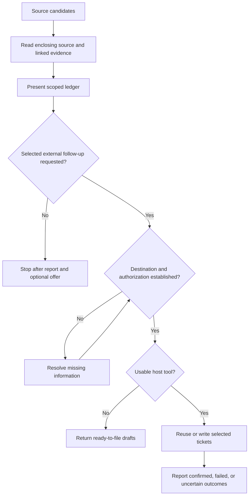

# Native Debt Documentation and Tracking - Plan

## Goal Capsule

- **Objective:** Developers can find deliberate shortcuts in their project's documentation style and carry selected follow-ups into their existing tracker.
- **Means:** Extend Ponytail's instruction-driven workflow and existing host tools (KTD1-KTD3).
- **Authority:** [Issue #1123](https://github.com/DietrichGebert/ponytail/issues/1123) defines the requested outcome; the Product Contract owns behavior, and the Planning Contract owns its implementation.
- **Delivery:** This document proposes implementation. The plan PR changes documentation only and does not close #1123. A later implementation PR must deliver U1-U3 together, with the evidence below, before claiming the issue resolved.
- **Execution:** Start scanner work with regression fixtures; use measured agent behavior for instruction changes. The implementing contributor owns integration, verification, and the implementation PR. Maintainers own acceptance and release.
- **Stop conditions:** Resolve a conflict with #1123 or an upstream change before proceeding. Missing host credentials prevent the affected external exercise, not local planning or tests; disclose the remaining proof boundary.

---

## Product Contract

### Summary

Use the project's native documentation conventions when recording deliberate shortcuts, and keep those records discoverable by `/ponytail-debt`.
Offer an optional handoff to GitHub Issues, Jira, or another existing tracker after the report.

### Problem Frame

The current rule names a shortcut's limit and revisit trigger, but its documented scan expects selected comment prefixes immediately before the marker.
That misses ordinary documentation-block continuation lines and unprefixed marker lines inside docstrings.
The debt skill offers a local ledger file, while teams may already assign and revisit work in an external tracker.

### Requirements

**Native documentation and discovery**

- R1. Record a real shortcut's limit and revisit trigger using the project's existing comment or documentation convention, including JSDoc, TSDoc, Javadoc, and docstrings where appropriate. Extend declaration documentation when the limitation belongs there; use ordinary comments for local implementation details.
- R2. Preserve the neutral `shortcut:` default, legacy `ponytail:` discovery, custom marker support, and project instructions choosing another marker or none. Do not invent a universal documentation tag, duplicate an existing explanation, or move internal detail into public API documentation solely to satisfy the marker rule.
- R3. Discover supported marker text in inline comments, documentation openers, continuation lines, and docstrings, then inspect its source context before counting it as debt. Exclude ignored files, illustrative prose/examples, ordinary string data, and non-deferrals; read wrapped text before deciding a trigger is missing.

**Reporting and external follow-up**

- R4. A plain ledger request remains read-only and preserves source locations, counts, and missing-trigger reporting for inspected debt. An empty source scan reports no local markers, without asserting that the project or its tracker has no debt.
- R5. Offer to draft, create, or update selected items using the project's tracker and the host's existing capabilities. External writes require user authorization covering the selected items and destination; an explicit creation request already supplies that authorization.
- R6. Carry the source location, limit, and revisit trigger into each ticket, reusing an existing linked ticket rather than creating another. Preserve unrelated ticket content; when no usable write tool exists, return ready-to-file text without claiming a ticket was created.
- R7. Honor project guidance choosing comments, the tracker, or both. When a marker refers to a ticket as the detailed record, use accessible ticket content; otherwise retain the link and report unverified fields rather than classifying an unread trigger as missing. Code-link edits need authorization covering source edits, and ticket-only projects do not acquire markers merely because a scan ran.
- R8. Report successful, failed, and uncertain writes separately, with returned or verified ticket references. Reconcile an uncertain outcome before retrying; preserve the local report and drafts when an external action fails.

### Key Decisions

- **Keep project overrides and the opinionated default.** The current FAQ and #887 already address opting out; a new global setting would duplicate that mechanism. Governs R1-R2, R7.
- **Keep external persistence optional.** The existing reporting boundary remains useful across hosts with different tool access. Governs R4-R8.

### Acceptance Examples

| Example | Given and action | Expected result | Covers |
|---|---|---|---|
| AE1 | A real marker occupies a `*` continuation line or a Python docstring; request the ledger. | Include its source location and complete limit/trigger. | R1-R3 |
| AE2 | Marker text occurs in a string literal, Markdown example, ignored bundle, or keyboard-shortcut explanation. | No debt row for that text. | R3 |
| AE3 | Request only the ledger, or use a ticket-only project with no local markers. | No writes; scope the empty result to local source. | R4, R7 |
| AE4 | Request tickets for selected rows in a named project; one row already links a ticket. | Reuse the linked ticket and create only the missing item without asking for the same authorization again. | R5-R6 |
| AE5 | Tracker access is absent, read-only, or fails after one confirmed creation. | Return drafts or failures per item, preserve confirmed links, and never invent success. | R6, R8 |
| AE6 | A link-only marker points to an unreadable ticket, or a write times out without a clear result. | Mark metadata or completion unverified; inspect before retrying. | R7-R8 |

### Scope Boundaries

This extends existing skills and command copies. It adds no skill, provider adapter, credential setup, synchronization service, persistent debt registry, or general language parser.
Project-wide tracker inventory and automatic migration of old markers are outside this change.
Review and audit continue treating a deliberate shortcut as a decision rather than automatically reporting it as a defect.

---

## Planning Contract

### Key Technical Decisions

- KTD1. **Use broad candidate discovery followed by contextual reading.** Keep the existing `git grep --no-index --exclude-standard` file-selection behavior, search marker text without requiring one comment prefix, and inspect the enclosing source/documentation before admitting a row under R3. Treat a custom marker as literal text. This finds native docstrings without a parser dependency; lexical tests prove discovery, while agent evaluation proves classification.
- KTD2. **Keep authoring guidance in the canonical rule and its existing copies.** Preserve the literal marker contract that current copy tests enforce, then add the native-documentation qualification for R1-R2. Follow [JSDoc comment placement](https://jsdoc.app/about-getting-started), [TSDoc's documentation sections](https://tsdoc.org/pages/tags/remarks/), and [Javadoc's declaration/comment rules](https://docs.oracle.com/en/java/javase/25/docs/specs/javadoc/doc-comment-spec.html); those formats are not interchangeable tag vocabularies.
- KTD3. **Let the host execute the tracker handoff.** The debt instructions own selection, destination, authorization, link reuse, and failure reporting under R5-R8. Use existing CLI/MCP/API tools as available; do not change adapters or add a tracker protocol to Ponytail. Read only linked or user-requested tracker items rather than enumerating every accessible project.
- KTD4. **Prove instruction behavior separately from tool execution.** Use the existing three-arm benchmark for authoring/reporting, and an isolated host-tool exercise for ticket mutation. The current runner disables Bash and MCP and tells tasks to write code, so neither an unchanged runner nor a green regex test can establish external workflow correctness.

### High-Level Technical Design

The diagram sequences R3-R8; the requirements define authorization and reporting at each branch.

### Assumptions and Dependencies

- The new behavior remains instruction-driven; the repository has no scanner module or tracker service to extend.
- Documentation examples plus a short rule qualification are sufficient for native authoring; the required benchmark must test this assumption before implementation is accepted.
- #1117 is open at the research base. Its prefix expansion is related work, not an implementation dependency; refresh its state and preserve any merged coverage when changing candidate discovery.
- The maintainer has not accepted #1123. This plan provides a reviewable proposal and does not imply acceptance of the feature or its benchmark results.

---

## Implementation Units

### U1. Native authoring and complete source discovery

**Goal:** Implement R1-R4 and the source-record portion of R7.
**Dependencies:** None.

**Files:** `skills/ponytail/SKILL.md`, `AGENTS.md`, `hooks/ponytail-instructions.js`, `commands/ponytail.toml`, `.opencode/command/ponytail.md`; compact copies in `.agents/rules/ponytail.md`, `.clinerules/ponytail.md`, `.cursor/rules/ponytail.mdc`, `.github/copilot-instructions.md`, `.kiro/steering/ponytail.md`, `.qoder/rules/ponytail.md`, `.windsurf/rules/ponytail.md`; `skills/ponytail-debt/SKILL.md`, `commands/ponytail-debt.toml`, `.opencode/command/ponytail-debt.md`; generated `.openclaw/skills/ponytail/SKILL.md` and `.openclaw/skills/ponytail-debt/SKILL.md`; `tests/commands.test.js`, `tests/gemini-extension.test.js`, `pi-extension/test/helpers.test.js`.

**Approach:** Apply KTD1-KTD2 at the existing owners. Update the debt text to distinguish candidate hits from admitted rows and to scope the empty result under R4. Regenerate OpenClaw output using the existing generator. Inspect review/audit wording for compatibility without changing its decision policy.

**Patterns:** `tests/commands.test.js` extracts and runs commands from all four debt surfaces; `scripts/check-rule-copies.js` and `tests/openclaw-skills.test.js` establish copy parity.

**Execution note:** Characterize old discovery failures before replacing the expression. Existing tests that reject prose at the candidate stage must move that expectation to contextual classification, not silently disappear.

**Test scenarios:**

1. Covers AE1: actual expressions from every surface discover current and legacy markers in inline comments, documentation openers, continuation lines, and single-/double-triple-quoted docstrings, including indentation and tabs.
2. Covers AE2: preserve the temporary-repository fixture proving ignored files and `.git` are excluded; use U3's behavioral evaluation for admitted-row false positives.
3. A custom word containing regex metacharacters is treated literally and cannot change the command's meaning.
4. Covers AE3: zero candidates yields the scoped local result; the existing marker string and all shipped copies remain compatible.

**Verification:** Discovery fixtures fail against the old documented scan and pass against each new copy; U3 supplies authoring, classification, and read-only proof.

### U2. Optional external tracker handoff

**Goal:** Implement R5-R8 across every debt entry point.
**Dependencies:** U1.

**Files:** `skills/ponytail-debt/SKILL.md`, `commands/ponytail-debt.toml`, `.opencode/command/ponytail-debt.md`, generated `.openclaw/skills/ponytail-debt/SKILL.md`; behavioral cases/scorers in `benchmarks/agentic/tasks.py`; host-exercise specification in `benchmarks/agentic/README.md`.

**Approach:** Apply KTD3 without changing host adapters. Replace unconditional condensed-command prohibitions that conflict with authorized persistence, while retaining R4 as the default. Keep linked-ticket metadata and outcomes explicit under R7-R8.

**Patterns:** Reuse the skill's existing opt-in ledger-file persistence boundary and the thin-adapter principle in `docs/agent-portability.md`.

**Test scenarios:**

1. Covers AE3-AE4: report-only and declined offers cause no writes; explicit creation requests use the established destination and authorization.
2. Covers AE4: an existing link is reused, unrelated ticket content survives, and a repeat invocation does not duplicate the confirmed item.
3. Covers AE5-AE6: no tool, read-only tool, permission denial, one successful/one failed item, and uncertain completion produce distinct honest results.
4. Covers AE6: unread linked content remains unverified, while inspected content lacking a trigger is flagged as such.
5. A ticket-only project stays free of new source comments; source linking occurs only with authority covering source edits.

**Verification:** U3's report evaluation and isolated host-tool exercise establish the scenarios; static phrase assertions alone do not establish this unit's behavior.

### U3. Behavioral evidence, documentation, and release parity

**Goal:** Establish that U1-U2 satisfy the Product Contract on the published surfaces.
**Dependencies:** U1, U2.

**Files:** `benchmarks/agentic/tasks.py`, `benchmarks/agentic/run.py`, `benchmarks/agentic/README.md`, a dated results document under `benchmarks/results/`; `README.md`, `i18n/README.es.md`, `i18n/README.ja.md`, `i18n/README.ko.md`, `i18n/README.zh-CN.md`; existing copy validation in `tests/openclaw-skills.test.js` and `scripts/check-rule-copies.js`.

**Approach:** Reuse `baseline`, `ponytail`, and `ponytail2` with the existing plugin-directory overrides. Add only a task-scoped prompt choice where a report task must avoid the runner's code-writing instruction; retain that instruction for existing coding tasks. Seed representative source files and load the actual debt skill for report cases. Score final responses and unchanged source bytes; calibrate every new scorer with known good and bad references. Document supported examples and the limits of evidence, then extend the existing FAQ and translations.

**Test scenarios:**

1. Covers AE1-AE2: an authoring case uses native documentation without duplication or invented tags; a report case admits real debt and rejects prose, string data, and examples. A wrapped trigger is recovered from context.
2. Covers AE3: report tasks leave seed files unchanged; deliberately bad references that modify source or claim a ticket was created fail their scorers.
3. Existing coding tasks retain their original prompt; run `conv-service` and `cache` as regression tasks for project conventions and unnecessary scaffolding.
4. Covers AE4-AE6: use an isolated host session with synthetic source and a disposable tracker destination to verify returned links, persisted fields, reuse, and lack of unauthorized source edits. Use a controlled tool double for denied access and uncertain/partial responses; document which outcomes were real and which were injected.
5. Exercise canonical and condensed debt entry points against the same cases; generated OpenClaw content matches canonical content.

**Verification:** Satisfy the Verification Contract, retain redacted evidence, and remove experimental scaffolding that did not contribute to the final result.

---

## Verification Contract

The implementation must satisfy `.github/CONTRIBUTING.md`; this planning document does not claim those results.

| Gate | Required evidence |
|---|---|
| Repository suite | `npm test`, including the Pi extension suite, passes on the implementation revision. CI uses Node 22 and Python 3.12 with pandas. |
| Rule and package parity | `node scripts/check-rule-copies.js` and `node scripts/check-versions.js` pass; generated OpenClaw bodies match source. |
| Scorer sensitivity | `benchmarks/agentic/run.py --selftest` accepts known-good and rejects known-bad references for every new task. |
| Three-arm comparison | Same task and current model, at least six runs per arm: no Ponytail, current upstream main, and candidate. Include native authoring/reporting improvement tasks and existing regression tasks; record exact revisions, model, per-run behavior, cost, and aggregate results. |
| External operation | A redacted host-tool transcript correlates approved inputs with durable ticket fields and verified links; controlled failures prove R6-R8. Disabled-tool benchmark results cannot substitute for this evidence. |

For behavioral acceptance, every candidate run must satisfy the applicable requirements, including zero unauthorized writes and zero fabricated ticket references.
Report the measured improvement and any regression rather than treating a small sample as a universal guarantee; a failed requirement or unexplained regression prevents claiming the implementation complete.

---

## Definition of Done

- U1-U3 satisfy their scenarios and every R-ID has behavioral or source-level evidence at the appropriate boundary.
- Native documentation coverage includes the stated formats without claiming a universal parser.
- Copy parity, generated outputs, documentation, and translations describe the same behavior.
- The implementation PR includes the required benchmark and host-tool evidence, links #1123, and preserves relevant upstream changes.
- No abandoned experiments, new provider adapters, or unrelated changes remain. A plan-only PR does not meet this implementation definition of done.

---

## Sources and History

Research base: [2961b52](https://github.com/DietrichGebert/ponytail/commit/2961b52fc1fe6a5a87c7a959a79512e5c2f3ffe5).
These references establish compatibility constraints; they do not authorize reverting prior decisions.

| Reference | Verified history | Constraint carried forward |
|---|---|---|
| [#1123](https://github.com/DietrichGebert/ponytail/issues/1123) | Open feature proposal | Native documentation and optional external follow-up are one requested outcome. |
| [#40](https://github.com/DietrichGebert/ponytail/pull/40), [d9e1480](https://github.com/DietrichGebert/ponytail/commit/d9e1480c74986fcc7ff3c18e1773f5364e17deed) | Merged debt skill | Preserve reporting as the default. |
| [#577](https://github.com/DietrichGebert/ponytail/pull/577), [b6c0448](https://github.com/DietrichGebert/ponytail/commit/b6c04480c03e8db2f035751d7c46289779ec3362) | Merged response to [#120](https://github.com/DietrichGebert/ponytail/issues/120) | Mark real corner-cuts, not ordinary edits. |
| [#815](https://github.com/DietrichGebert/ponytail/pull/815), [b52dd9b](https://github.com/DietrichGebert/ponytail/commit/b52dd9b07206fb6c6f94df52a839161aaea20d11) | Merged block-comment and scan exclusions | Retain existing comment coverage. |
| [#1068](https://github.com/DietrichGebert/ponytail/pull/1068), [2a1fe84](https://github.com/DietrichGebert/ponytail/commit/2a1fe842d078cf66ec7f3e6096a8ca4279c2cad7) | Merged neutral marker and custom-word support | Keep legacy discovery and project override behavior. |
| [#1108](https://github.com/DietrichGebert/ponytail/pull/1108), [57635bd](https://github.com/DietrichGebert/ponytail/commit/57635bd8afff7f584396352e8a88bde3d959648a) | Merged Git-aware scan | Preserve `.gitignore` selection without per-framework exclusions. |
| [#1076](https://github.com/DietrichGebert/ponytail/pull/1076), [#1117](https://github.com/DietrichGebert/ponytail/pull/1117) | #1076 closed unmerged; #1117 open at research time | Reconcile related prefix coverage before implementation; neither is a merged prerequisite. |
| [#887](https://github.com/DietrichGebert/ponytail/issues/887#issuecomment-5965522086) | Maintainer declined a global opt-out after testing project instructions | Use established project guidance instead of new settings. |

The benchmark's tool restrictions and default task prompt are defined in `benchmarks/agentic/run.py`; task fixtures and scorer self-checks live in `benchmarks/agentic/tasks.py`.
Contribution requirements live in `.github/CONTRIBUTING.md`.
