<p align="center">
  <picture>
    <source media="(prefers-color-scheme: dark)" srcset="../assets/logo-dark.png">
    
  </picture>
</p>

<h1 align="center">Ponytail</h1>

<p align="center" dir="rtl">
  <em>لا يقول شيئًا. يكتب سطرًا واحدًا. ويعمل.</em>
</p>

<p align="center">
  <a href="https://trendshift.io/repositories/50668?utm_source=repository-badge&amp;utm_medium=badge&amp;utm_campaign=badge-repository-50668" target="_blank" rel="noopener noreferrer"></a>
</p>

<p align="center">
  
  
  
  
  
</p>

<p align="center">
  <a href="https://ponytail.dev/stories">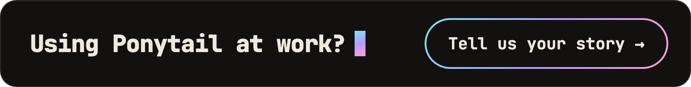</a>
</p>

<p align="center">
  <a href="https://trendshift.io/repositories/50668" target="_blank" rel="noopener noreferrer"></a>
  <a href="https://trendshift.io/repositories/50668" target="_blank" rel="noopener noreferrer"></a>
  <a href="https://trendshift.io/repositories/50668?utm_source=trendshift-badge&amp;utm_medium=badge&amp;utm_campaign=badge-trendshift-50668" target="_blank" rel="noopener noreferrer"></a>
</p>

<p align="center">
  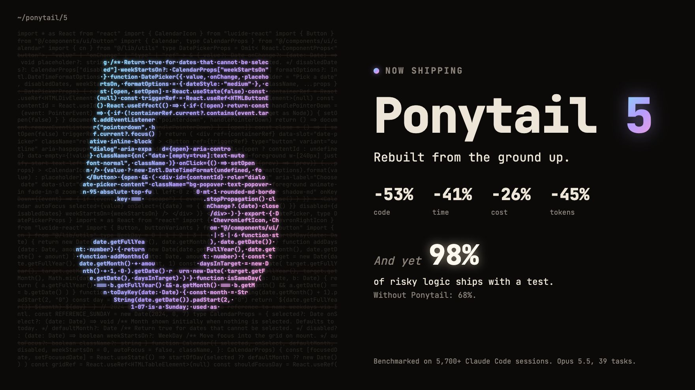
</p>

<p align="center" dir="rtl">
  <strong>Ponytail 5: أُعيد بناؤه من الصفر.</strong><br>
  <strong>كود أقل بنسبة 53% &middot; وقت أقل بنسبة 41% &middot; تكلفة أقل بنسبة 26% &middot; توكنز أقل بنسبة 45%</strong><br>
  <strong>ومع ذلك: 98% من المنطق المحفوف بالمخاطر يخرج ومعه اختبار.</strong> بدون Ponytail: 68%.<br>
  <sub>قِيس في Claude Code، نفس الوكيل مع المهارة وبدونها: 39 مهمة منها مستودع FastAPI + React حقيقي، Opus 5.5، 5 تشغيلات لكل مهمة. <a href="#numbers">التفاصيل</a>.</sub>
</p>

<p align="center">
  <sub><a href="../README.md">English</a> &middot; <a href="README.es.md">Español</a> &middot; <a href="README.ko.md">한국어</a> &middot; <a href="README.zh-CN.md">简体中文</a> &middot; <a href="README.ja.md">日本語</a></sub>
</p>

---

<p align="center">
  <a href="https://ponytail.dev/soon">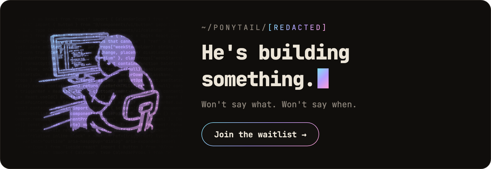</a>
</p>

<h2 dir="rtl">مشاريع بُنيت بالفعل بـ Ponytail</h2>

<a href="https://theretriever.app">
  <picture>
    <source media="(prefers-color-scheme: dark)" srcset="../assets/retriever-logo-dark.svg">
    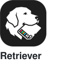
  </picture>
</a>
<a href="https://photoreunion.app/?ref=ponytail-gh">
  <picture>
    <source media="(prefers-color-scheme: dark)" srcset="../assets/photoreunion-logo-dark.svg">
    
  </picture>
</a>
<a href="https://braids.page/?ref=ponytail-gh">
  <picture>
    <source media="(prefers-color-scheme: dark)" srcset="../assets/braids-logo-dark.svg">
    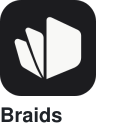
  </picture>
</a>

---

<p dir="rtl">
تعرفه جيدًا. ذيل حصان طويل. نظارة بيضاوية. موجود في الشركة من قبل نظام إدارة الإصدارات نفسه. تعرض عليه خمسين سطرًا؛ ينظر إليها، لا يقول شيئًا، ويستبدلها بسطر واحد.
</p>

<p dir="rtl">
Ponytail يضع هذا الرجل داخل وكيل الذكاء الاصطناعي بتاعك.
</p>

<h2 dir="rtl">الأرقام</h2>

<p align="center">
  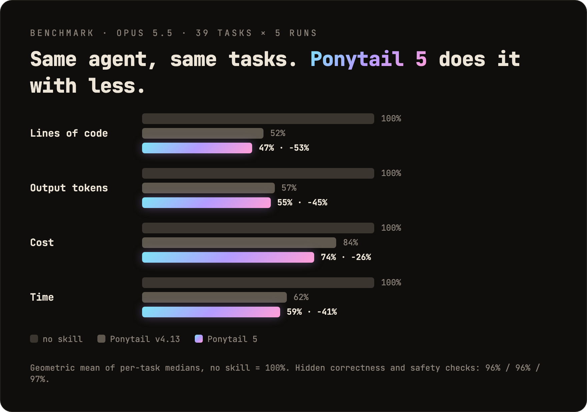
</p>

<p align="center">
  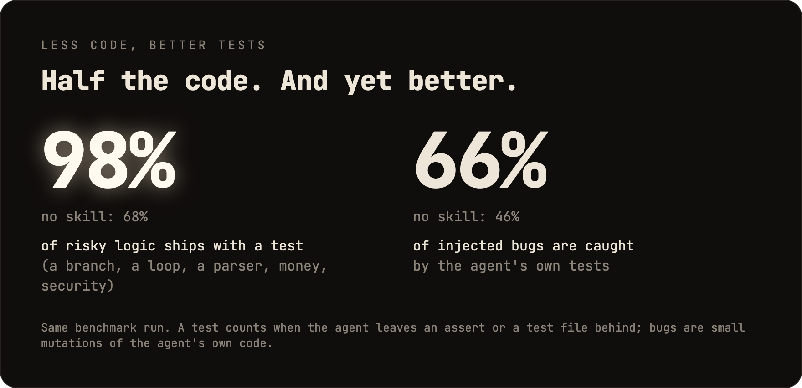
</p>

<p dir="rtl">
شيئان لا يظهرهما الرسم البياني: في مقارنة عمياء، تفوّقت ردود Ponytail 5 على النسخة السابقة 110 مقابل 67. وفي مهام الأمان الست (حقن SQL، اجتياز المسارات، توكنز مزوّرة، تحديد المعدل، صفوف CSV تالفة، التخزين المؤقت) نجح في كل التشغيلات الثلاثين: كود أقل، دون أي تفريط في الأمان. المنهجية وجداول كل مهمة والحدود: <a href="../benchmarks/results/2026-10-07-agentic.md">benchmarks/results/2026-10-07-agentic.md</a>.
</p>

<p dir="rtl">
<strong>القاعدة لم تكن يومًا "أقل عدد ممكن من التوكنز".</strong> القاعدة هي: اكتب فقط ما تحتاجه المهمة، ولا تقتطع أبدًا من التحقق من المدخلات أو معالجة الأخطاء أو الأمان أو إمكانية الوصول. الكود يخرج صغيرًا لأنه ضروري، لا لأنه مضغوط قسرًا. انخفاض التكلفة وسرعة الاستجابة مجرد أثر جانبي.
</p>

<h2 dir="rtl">قبل / بعد</h2>

<p align="center">
  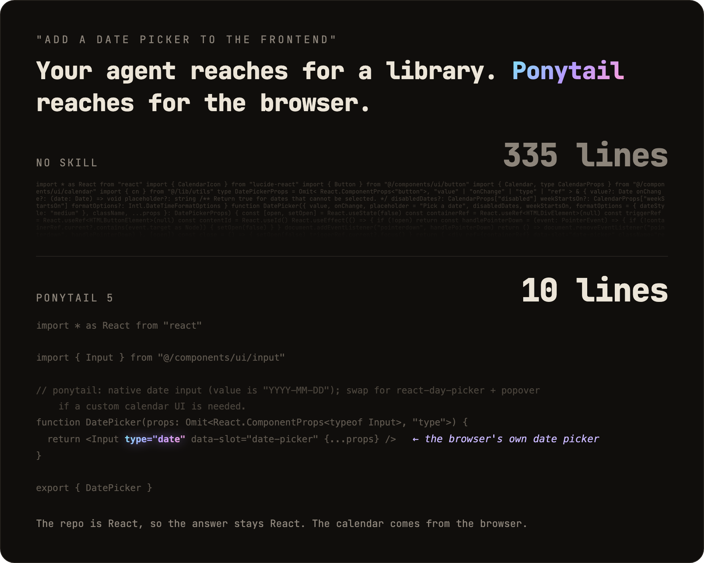
</p>

<p dir="rtl">
تطلب منتقي تاريخ. بدون Ponytail، يثبّت الوكيل مكتبة منتقي تاريخ أو يبني تقويمًا كاملًا بيده: 335 سطرًا. Ponytail 5 ينظر أولًا إلى الموجود بالفعل: المستودع فيه مكوّن <code>Input</code>، وكل متصفح فيه منتقي تاريخ. يجمع بين الاثنين. 10 أسطر.
</p>

<p dir="rtl">
المزيد من القصص الناجية في مجلد <a href="../examples/">examples/</a>.
</p>

<h2 dir="rtl">المراجعة، بعد إعادة بنائها</h2>

<p align="center">
  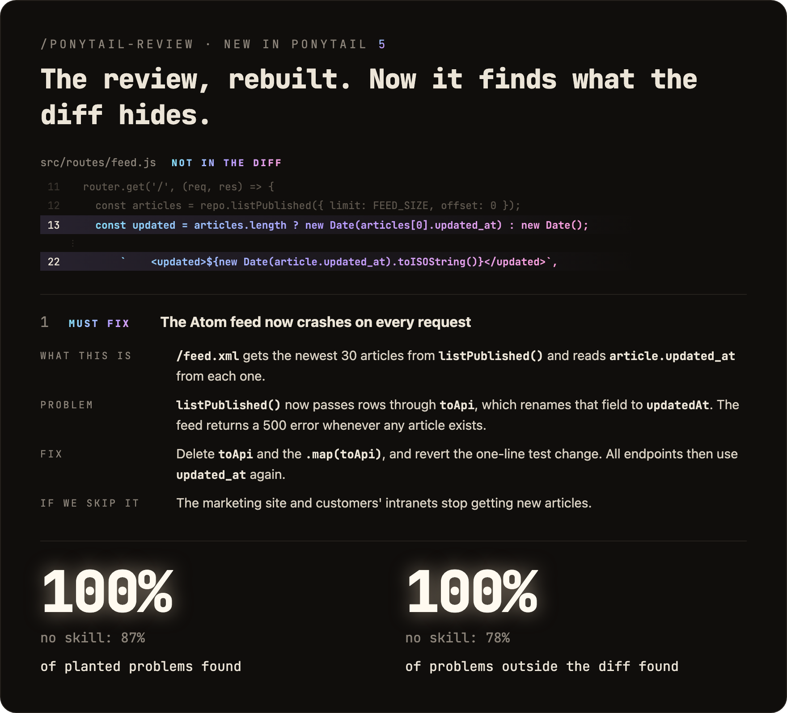
</p>

<p dir="rtl">
كان <code>/ponytail-review</code> يبحث فقط عن كود يمكن حذفه. الآن يراجع كما يراجع المطوّر الكبير الذي يُستدعى عندما ينكسر النظام: يقرأ الكود الذي يلمسه تغييرك، وليس مجرد الـ diff، ويفحص الأخطاء والأمان والحمل الحقيقي والاختبارات الناقصة والأداء وما يمكن الاستغناء عنه. كل ملاحظة تشرح ماذا يفعل الكود، وما الخطأ، وكيف تصلحه، وماذا يحدث لو لم تفعل.
</p>

<h2 dir="rtl">التدقيق، بعد إعادة بنائه</h2>

<p align="center">
  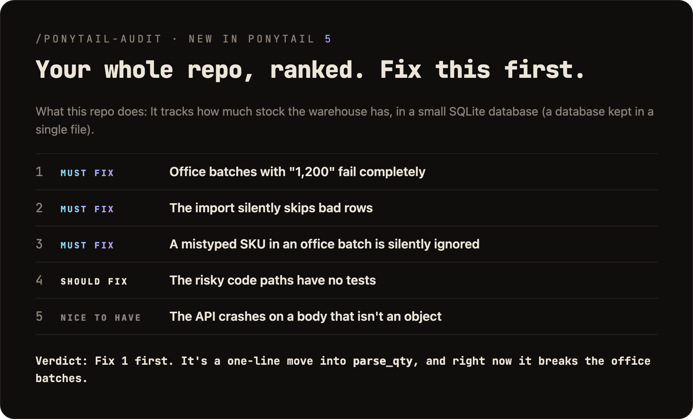
</p>

<p dir="rtl">
يشغّل <code>/ponytail-audit</code> نفس الفحوصات على المستودع كله. يرسم خريطة للكود أولًا: نقاط الدخول، وكيف تتحرك البيانات، وما الحمل الذي يتوقعه المشروع. ثم يرتّب ما يجده ويخبرك بما تصلحه أولًا. التدقيق القديم كان يكتفي بسرد ما يجب حذفه.
</p>

<h2 dir="rtl">الجديد في 5.3: الشريط</h2>

<p align="center">
  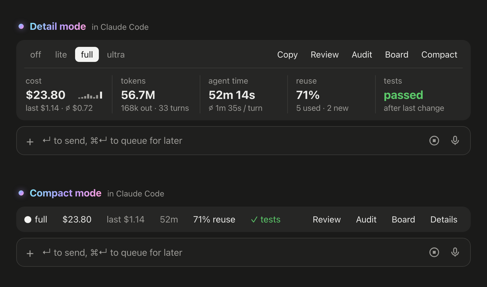
</p>

<p dir="rtl">
في Claude Code، يعرض ponytail الآن شريطًا فوق سطر الأوامر: تكلفة المهمة الحالية، وكم توكن وكم وقت وكيل استهلكت، وكم مرة أعاد استخدام كود موجود بدل كتابة كود جديد، وهل نجحت الاختبارات بعد آخر تغيير. أزراره تبدّل المستوى، وتشغّل <code>/ponytail-review</code> أو <code>/ponytail-audit</code>، وتنسخ المهمة كـ Markdown، وتطوي الشريط في سطر واحد. لا تريده؟ <code>/ponytail band</code> يخفيه، ونفس الأمر يعيده. يحتاج Claude Code 2.1.290 أو أحدث، في الطرفية أو تطبيق سطح المكتب. لا يظهر في لوحة دردشة VS Code ولا في جلسات السحابة ولا مع <code>claude -p</code>.
</p>

<p align="center">
  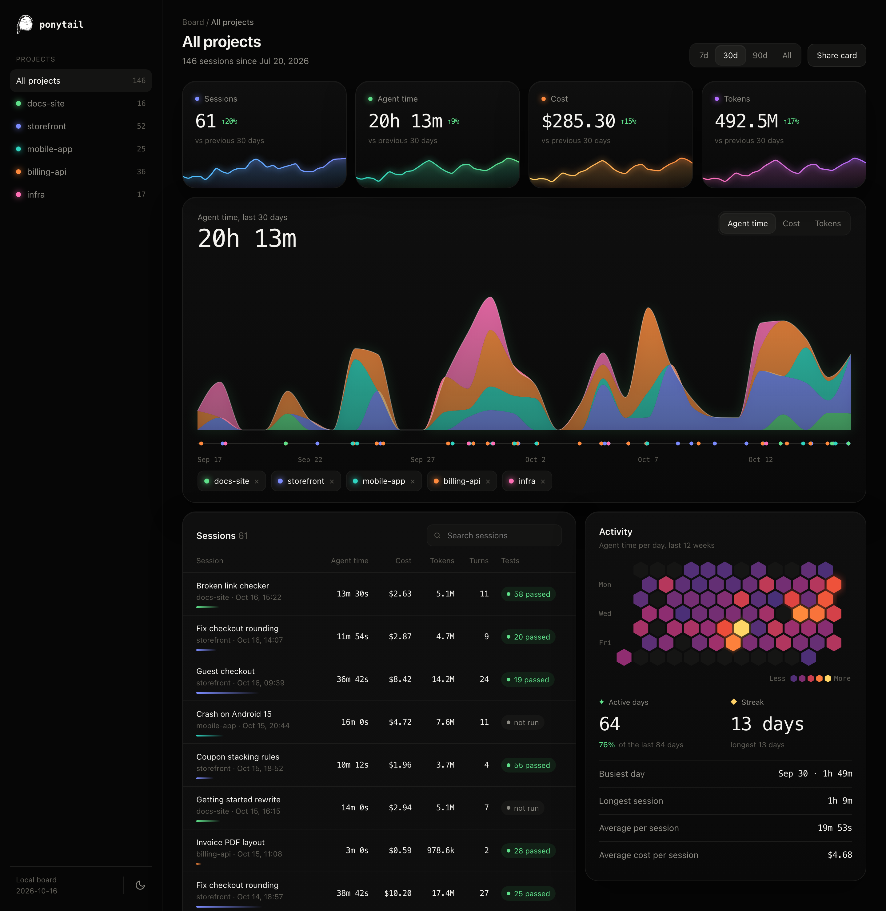
</p>

<p dir="rtl">
<strong>اللوحة</strong> تفتح صفحة محلية بكل مهمة عبر مشاريعك: التكلفة ووقت الوكيل والتوكنز عبر الزمن، وكل جلسة باختباراتها، والأيام التي عملت فيها. افتراضيًا كل شيء يبقى على جهازك، في <code>~/.config/ponytail/band/</code>. أمر <code>/ponytail band import</code> يضيف جلسات Claude Code السابقة إليها، بتكلفتها ووقت وكيلها وتوكنزها.
</p>

<h2 dir="rtl">كيف يعمل</h2>

<p align="center">
  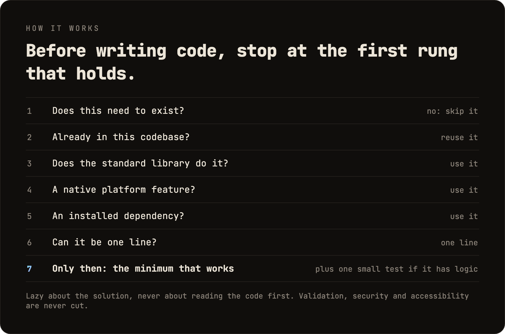
</p>

<p dir="rtl">
السلّم يعمل <em>بعد</em> فهم المشكلة، لا بدلًا عنه: يقرأ الكود الذي يلمسه التغيير ويتتبع المسار الحقيقي قبل اختيار الدرجة. كسول في الحل، لا في القراءة أبدًا.
</p>

<p dir="rtl">
كسول لا مهمل: التحقق على حدود الثقة، ومعالجة فقدان البيانات، والأمان، وإمكانية الوصول، ليست مطروحة للحذف أبدًا.
</p>

<p dir="rtl">
أي منطق فيه تفرّع أو حلقة أو مُحلّل أو مال أو أمان يترك خلفه اختبارًا صغيرًا واحدًا. وكل رد ينتهي بما تم تخطيه أو لم يُفحص وأي مخاطرة يجب أن تعرفها.
</p>

<h2 dir="rtl">الموجّه</h2>

<p dir="rtl">
Ponytail موجّه واحد: <a href="../skills/ponytail/SKILL.md"><code>skills/ponytail/SKILL.md</code></a>. النسخة المضغوطة، للوكلاء الذين يقرأون ملف قواعد، هي <a href="../AGENTS.md"><code>AGENTS.md</code></a>. كل ما عدا ذلك في هذا المستودع يحمّل هذا الموجّه في وكلاء مختلفين.
</p>

<h2 dir="rtl">التثبيت</h2>

<p dir="rtl">
<strong>Claude Code</strong>، كموجّهين منفصلين:
</p>

```
/plugin marketplace add DietrichGebert/ponytail
```
```
/plugin install ponytail@ponytail
```

<p dir="rtl">
<strong>Codex:</strong>
</p>

```bash
codex plugin marketplace add DietrichGebert/ponytail
codex plugin add ponytail@ponytail
```

<p dir="rtl">
ثم افتح <code>/hooks</code> في Codex، وامنح الثقة لخطّافَي دورة الحياة، وابدأ خيطًا جديدًا.
</p>

<p dir="rtl">
<strong>أي وكيل آخر:</strong> انسخ <a href="../AGENTS.md"><code>AGENTS.md</code></a> إلى مشروعك، أو اطلب من وكيلك تثبيت <a href="../skills/ponytail/SKILL.md"><code>skills/ponytail/SKILL.md</code></a> كمهارة. خطوة بخطوة لـ Copilot وCursor وOpenCode وGemini وغيرها: <strong><a href="../INSTALL.md">INSTALL.md</a></strong>.
</p>

<p dir="rtl">
كان هذا كل شيء. كان سيفخر بك. لن يقولها طبعًا.
</p>

<p dir="rtl">
يعمل في كل جلسة، مع حفنة من الأوامر (انظر <a href="#commands">الأوامر</a>). ويوجد <code>/ponytail ultra</code> لحين يكون المستودع قد أساء إليك شخصيًا. نص البداية وتغيير الوضع يعرضان الوضع الحالي.
</p>

<p dir="rtl">
ثبّت ponytail فقط من <code>DietrichGebert/ponytail</code> على GitHub أو <code>@dietrichgebert/ponytail</code> على npm. لا يشحن أبدًا ملفات <code>.exe</code> أو <code>.dll</code>؛ أي نسخة تفعل ذلك ليست مني.
</p>

<h2 dir="rtl">الأوامر</h2>

| الأمر | ماذا يفعل |
|---------|--------------|
| `/ponytail [lite \| full \| ultra \| off]` | ضبط الشدة، أو إيقافه. بدون وسيط يشغّل ponytail على المستوى الافتراضي إن كان متوقفًا، وإلا يعرض المستوى الحالي. |
| `/ponytail band [on \| off]` | في Claude Code فقط: إخفاء أو إظهار الشريط فوق سطر الأوامر. بدون وسيط يبدّل حالته. المستوى يبقى كما هو. |
| `/ponytail band import` | في Claude Code فقط: إضافة جلسات Claude Code السابقة إلى اللوحة، بتكلفتها ووقت وكيلها وتوكنزها. |
| `/ponytail-review` | مراجعة الـ diff الحالي كما يراجع المطوّر الكبير الذي يُستدعى عند الكسر: أخطاء، أمان، حمل حقيقي، كود محفوف بالمخاطر بلا اختبار، مسارات بطيئة، وما يمكن حذفه. كل ملاحظة تشرح ماذا يفعل الكود، وما الخطأ، وكيف تصلحه، وماذا يحدث لو لم تفعل. حدّد هدفًا بكلمات عادية لتضييقه أو توسيعه: `uncommitted` أو `staged` أو `branch` أو رابط PR. |
| `/ponytail-audit` | نفس الفحص على المستودع كله، الأهم أولًا. |
| `/ponytail-debt` | يجمع تعليقات `shortcut:` التي أجّلتها في سجل، حتى لا يتحول "لاحقًا" إلى "أبدًا". |
| `/ponytail-gain` | عرض لوحة النتائج المقاسة (كود أقل، تكلفة أقل، سرعة أكبر) من الاختبار المعياري. |
| `/ponytail-help` | مرجع سريع للأوامر أعلاه. |

<p dir="rtl">
الأوامر تحتاج مضيفًا يدعم المهارات (Claude Code، Codex، Devin CLI، OpenCode، Gemini، Antigravity CLI، pi، Hermes Agent، Qoder، Grok Build). في Codex CLI وإضافة بيئة التطوير هي مهارات تحت فضاء أسماء الإضافة؛ استدعِها بـ <code>$ponytail:ponytail-review</code>. Cursor مع <a href="../INSTALL.md#cursor">الخطافات</a> يحصل على تبديل مستوى <code>/ponytail</code> فقط، ويُكتب كرسالة عادية. المحوّلات المعتمدة على التعليمات فقط (ملف قواعد Cursor، وWindsurf، وCline، وCopilot، وKiro، ومحوّل <code>AGENTS.md</code> في Antigravity) تحمّل مجموعة القواعد الدائمة بدون الأوامر.
</p>

<h2 dir="rtl">أسئلة شائعة</h2>

<p dir="rtl">
<strong>هل يحتاج ملف إعدادات؟</strong><br>
لا. يمكن لملف اختياري <code>~/.config/ponytail/config.json</code> أو متغير بيئة <code>PONYTAIL_DEFAULT_MODE</code> ضبط المستوى الافتراضي، لكن لا شيء مطلوب.
</p>

<p dir="rtl">
<strong>لماذا يكتب تعليقات <code>shortcut:</code>؟</strong><br>
تعلّم اختصارًا متعمدًا ومتى تعود إليه، و<code>/ponytail-debt</code> يجمعها في سجل. تريد كلمة أخرى أو لا كلمة إطلاقًا؟ قل ذلك في <code>CLAUDE.md</code> أو <code>AGENTS.md</code> في مشروعك، ثم شغّل <code>/ponytail-debt &lt;كلمتك&gt;</code>.
</p>

<p dir="rtl">
<strong>وماذا لو احتجت فعلًا إلى كلاس الكاش ذي الـ 120 سطرًا؟</strong><br>
لا تحتاجه. أصرّ وسيبنيه لك رغم ذلك. ببطء. وبشكل صحيح. وهو ينظر إليك.
</p>

<p dir="rtl">
<strong>هل يتوسع؟</strong><br>
الكود الذي لم تكتبه يتوسع بلا حدود. صفر أخطاء، صفر ثغرات CVE، وجاهزية 100% منذ الأزل.
</p>

<p dir="rtl">
<strong>لماذا "ponytail"؟</strong><br>
تعرف الإجابة تمامًا.
</p>

<h2 dir="rtl">الرعاة</h2>

<p align="center">
  <a href="https://greenpt.com/">
    <picture>
      <source media="(prefers-color-scheme: dark)" srcset="../assets/logo-greenpt-dark.svg">
      
    </picture>
  </a>
</p>

<h2 dir="rtl">الرخصة</h2>

<p dir="rtl">
<a href="../LICENSE">MIT</a>. أقصر رخصة تؤدي الغرض.
</p>

<h2 dir="rtl">تاريخ النجوم</h2>

<a href="https://www.star-history.com/dietrichgebert/ponytail#history">
 <picture>
   <source media="(prefers-color-scheme: dark)" srcset="https://api.star-history.com/chart?repos=DietrichGebert/ponytail&type=Date&theme=dark" />
   <source media="(prefers-color-scheme: light)" srcset="https://api.star-history.com/chart?repos=DietrichGebert/ponytail&type=Date" />
   
 </picture>
</a>
