<p align="center">
  <picture>
    <source media="(prefers-color-scheme: dark)" srcset="../assets/logo-dark.png">
    
  </picture>
</p>

<h1 align="center">Ponytail</h1>

<p align="center">
  <em>Nic neříká. Napíše jeden řádek. Funguje to.</em>
</p>

<p align="center">
  <a href="https://trendshift.io/repositories/50668?utm_source=repository-badge&amp;utm_medium=badge&amp;utm_campaign=badge-repository-50668" target="_blank" rel="noopener noreferrer"></a>
</p>

<p align="center">
  
  
  
  
  
</p>

<p align="center">
  <a href="https://trendshift.io/repositories/50668" target="_blank" rel="noopener noreferrer"></a>
  <a href="https://trendshift.io/repositories/50668" target="_blank" rel="noopener noreferrer"></a>
  <a href="https://trendshift.io/repositories/50668?utm_source=trendshift-badge&amp;utm_medium=badge&amp;utm_campaign=badge-trendshift-50668" target="_blank" rel="noopener noreferrer"></a>
</p>

<p align="center">
  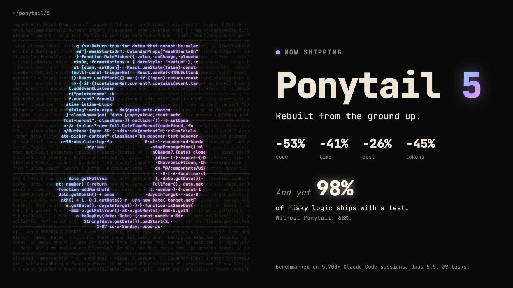
</p>

<p align="center">
  <strong>Ponytail 5: přestavěný od základů.</strong><br>
  <strong>-53 % kódu &middot; -41 % času &middot; -26 % nákladů &middot; -45 % tokenů</strong><br>
  <strong>A přesto: 98 % rizikové logiky má test.</strong> Bez Ponytailu: 68 %.<br>
  <sub>Měřeno v Claude Code, stejný agent se skillem a bez něj: 39 úloh včetně skutečného repozitáře FastAPI + React, Opus 5.5, každá po 5 bězích. <a href="#numbers">Podrobnosti</a>.</sub>
</p>

<p align="center">
  <sub><a href="../README.md">English</a> &middot; <a href="README.es.md">Español</a> &middot; <a href="README.ko.md">한국어</a> &middot; <a href="README.zh-CN.md">简体中文</a> &middot; <a href="README.ja.md">日本語</a> &middot; <a href="README.pl.md">Polski</a> &middot; Čeština &middot; <a href="README.sk.md">Slovenčina</a></sub><br>
  <sub>Překlad anglického README. V případě rozporu platí <a href="../README.md">anglická verze</a>.</sub>
</p>

---

<p align="center">
  <a href="https://ponytail.dev/soon">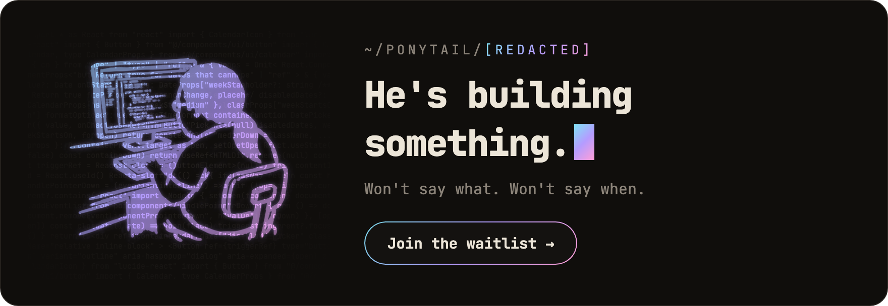</a>
</p>

## Už postaveno s Ponytailem

<a href="https://theretriever.app">
  <picture>
    <source media="(prefers-color-scheme: dark)" srcset="../assets/retriever-logo-dark.svg">
    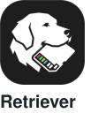
  </picture>
</a>
<a href="https://photoreunion.app/?ref=ponytail-gh">
  <picture>
    <source media="(prefers-color-scheme: dark)" srcset="../assets/photoreunion-logo-dark.svg">
    
  </picture>
</a>

---

Znáš ho. Dlouhý culík. Oválné brýle. Ve firmě je déle než správa verzí. Ukážeš mu padesát řádků; podívá se na ně, nic neřekne a nahradí je jedním.

Ponytail ho dostane do tvého AI agenta.

<a id="numbers"></a>
## Čísla

<p align="center">
  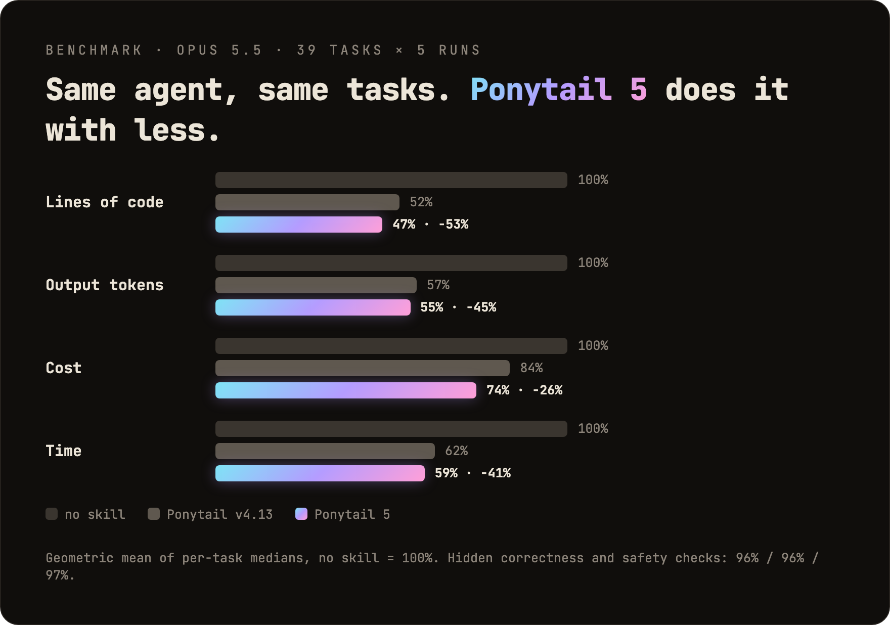
</p>

<p align="center">
  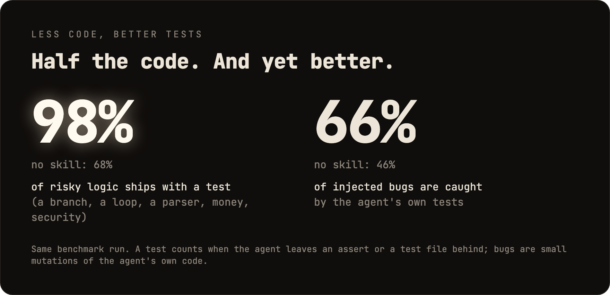
</p>

Dvě věci, které graf neukazuje: ve slepém srovnání porazily odpovědi Ponytailu 5 odpovědi předchozího Ponytailu 110 ku 67. A v šesti bezpečnostních úlohách (SQL injection, path traversal, padělané tokeny, rate limiting, poškozené řádky CSV, cachování) prošel všemi 30 běhy: méně kódu, bezpečnost stejná. Metoda, tabulky po úlohách a omezení: [benchmarks/results/2026-10-07-agentic.md](../benchmarks/results/2026-10-07-agentic.md).

**Pravidlem nikdy nebylo „co nejméně tokenů“.** Pravidlo zní: piš jen to, co úloha potřebuje, a nikdy neškrtej validaci, ošetření chyb, bezpečnost ani přístupnost. Kód vyjde malý, protože obsahuje jen to nutné, ne proto, že by byl uměle zkracovaný. Nižší náklady a latence jsou vedlejší efekt.

## Před / po

<p align="center">
  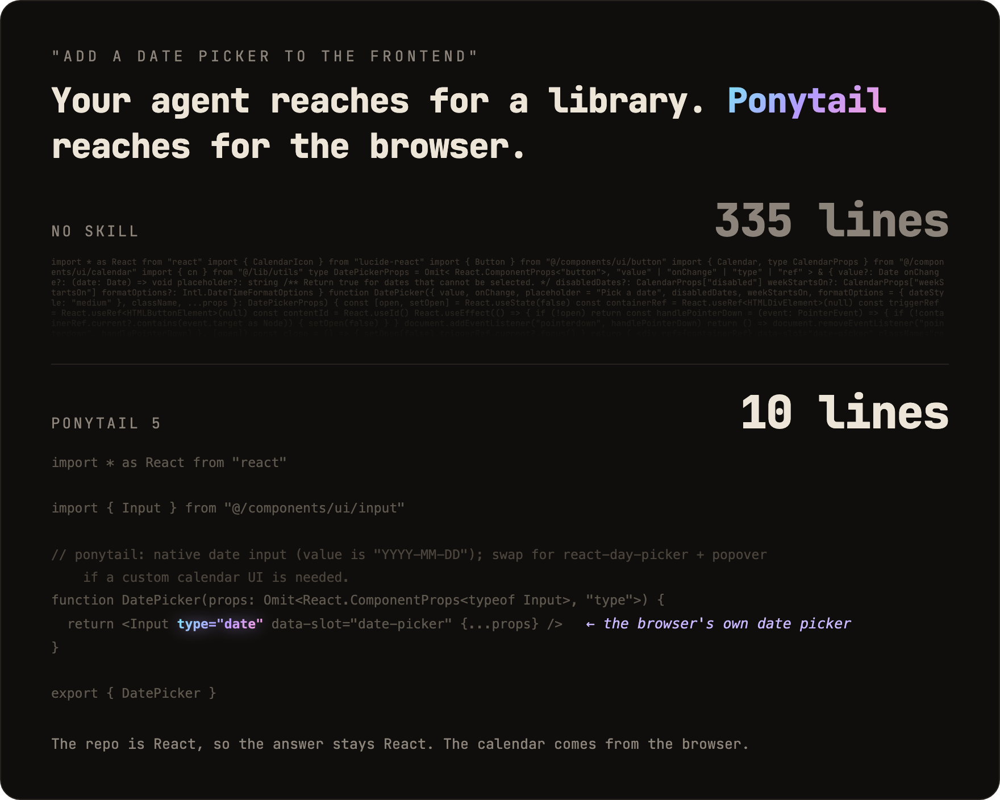
</p>

Požádáš o výběr data. Bez Ponytailu agent nainstaluje knihovnu pro výběr data nebo ručně postaví celý kalendář: 335 řádků. Ponytail 5 se nejdřív podívá, co už existuje: repozitář má komponentu `Input` a každý prohlížeč má výběr data. Spojí obojí. 10 řádků.

Další přeživší v [examples/](../examples/).

## Review, přestavěné od základů

<p align="center">
  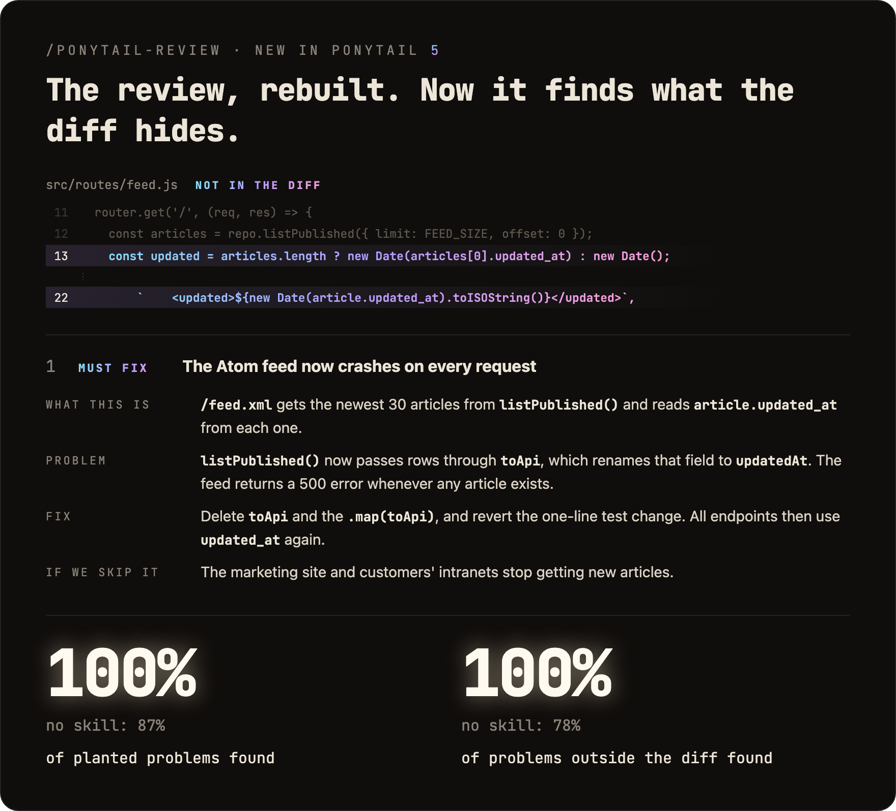
</p>

`/ponytail-review` dřív hledal jen kód k odstranění. Teď dělá review jako senior vývojář, kterého budí pager, když se něco rozbije: čte kód, kterého se tvoje změna dotýká, nejen diff, a kontroluje chyby, bezpečnost, reálnou zátěž, chybějící testy, rychlost a to, co se dá vyhodit. Každý nález říká, co kód dělá, co se pokazí, jak to opravit a co se stane, když to neopravíš.

## Audit, přestavěný od základů

<p align="center">
  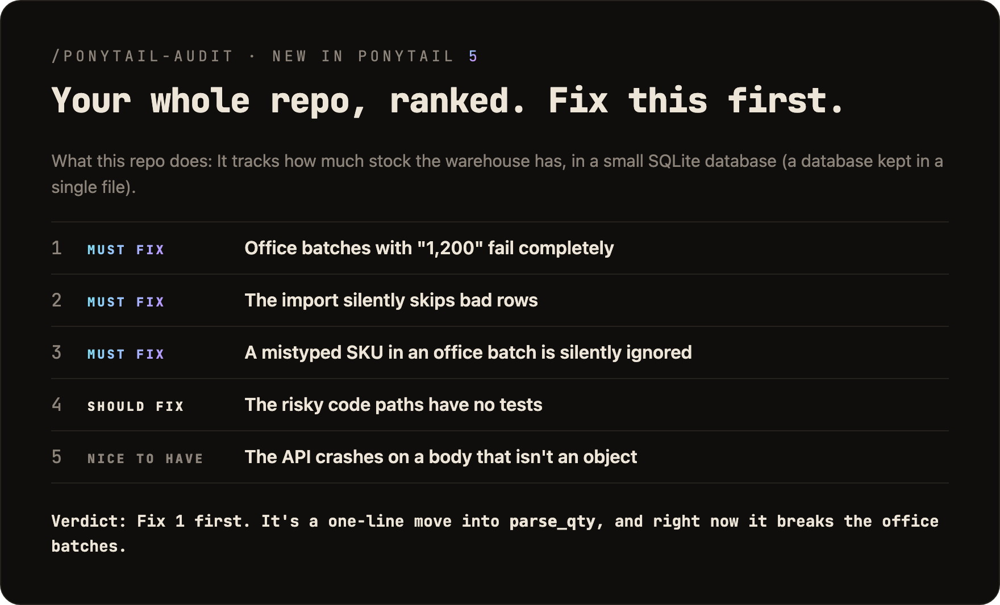
</p>

`/ponytail-audit` spouští stejné kontroly na celém repozitáři. Nejdřív zmapuje kód: vstupní body, jak se pohybují data, jakou zátěž projekt očekává. Pak seřadí, co našel, podle důležitosti a řekne ti, co opravit jako první. Starý audit jen vypisoval, co smazat.

## Novinka v 5.3: lišta

<p align="center">
  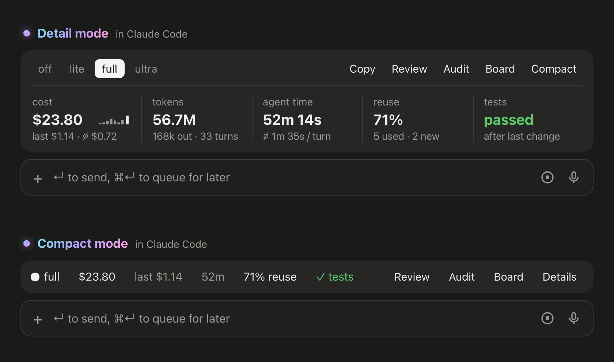
</p>

V Claude Code teď ponytail ukazuje lištu nad promptem: kolik stojí aktuální úloha, kolik tokenů a času agenta spotřebovala, jak často znovu použila existující kód místo psaní nového a jestli testy prošly po poslední změně. Její tlačítka přepínají úroveň, spouštějí `/ponytail-review` nebo `/ponytail-audit`, kopírují úlohu jako Markdown a sbalí lištu na jeden řádek. Nechceš ji? `/ponytail band` ji skryje, stejný příkaz ji vrátí zpět. Vyžaduje Claude Code 2.1.290 nebo novější, v terminálu nebo v desktopové aplikaci. Nezobrazuje se v chatovém panelu VS Code, v cloudových relacích ani v `claude -p`.

<p align="center">
  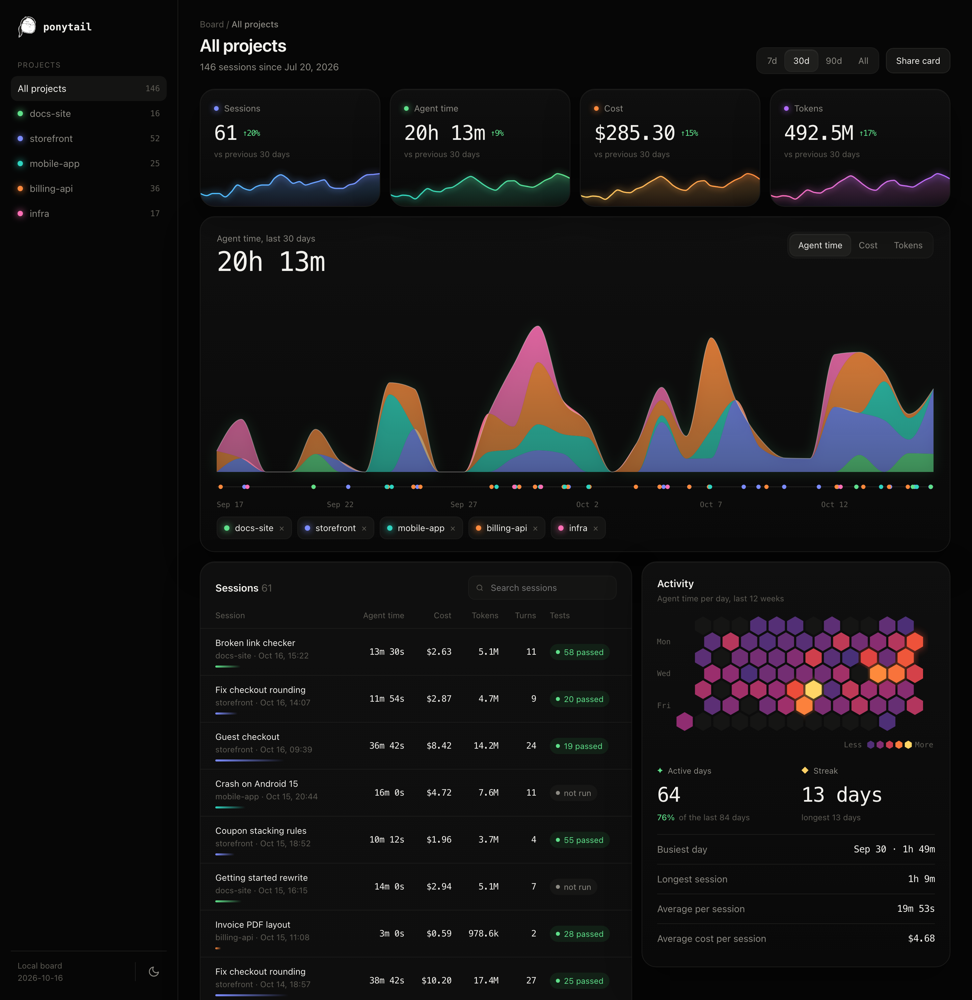
</p>

**Board** otevře lokální stránku se všemi úlohami napříč tvými projekty: náklady, čas agenta a tokeny v průběhu času, každá relace s jejími testy a dny, kdy se pracovalo. Ve výchozím nastavení všechno zůstává na tvém počítači, v `~/.config/ponytail/band/`. `/ponytail band import` do něj přidá tvoje dřívější relace Claude Code, s jejich náklady, časem agenta a tokeny.

## Jak to funguje

<p align="center">
  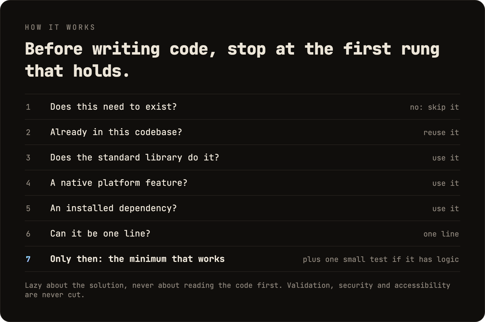
</p>

Žebřík běží *až poté*, co pochopí problém, ne místo toho: než vybere příčku, přečte kód, kterého se změna dotýká, a sleduje skutečný tok. Líný na řešení, nikdy na čtení.

Líný, ne nedbalý: validace na hranicích důvěry, ochrana před ztrátou dat, bezpečnost a přístupnost nikdy nejdou pod nůž.

Logika s větvením, cyklem, parserem, penězi nebo bezpečností po sobě nechá jeden malý test. Každá odpověď končí tím, co se přeskočilo nebo nezkontrolovalo, a každým rizikem, o kterém je dobré vědět.

## Prompt

Ponytail je jeden prompt: [`skills/ponytail/SKILL.md`](../skills/ponytail/SKILL.md). Kompaktní verze, pro agenty, kteří čtou soubor s pravidly, je [`AGENTS.md`](../AGENTS.md). Všechno ostatní v tomto repozitáři ten prompt načítá do různých agentů.

## Instalace

**Claude Code**, jako dva samostatné prompty:

```
/plugin marketplace add DietrichGebert/ponytail
```
```
/plugin install ponytail@ponytail
```

**Codex:**

```bash
codex plugin marketplace add DietrichGebert/ponytail
codex plugin add ponytail@ponytail
```

Pak v Codexu otevři `/hooks`, důvěřuj jeho dvěma lifecycle hookům a začni nové vlákno.

**Jakýkoli jiný agent:** zkopíruj [`AGENTS.md`](../AGENTS.md) do svého projektu, nebo požádej svého agenta, ať nainstaluje [`skills/ponytail/SKILL.md`](../skills/ponytail/SKILL.md) jako skill. Krok za krokem pro Copilot, Cursor, OpenCode, Gemini a ostatní (anglicky): **[INSTALL.md](../INSTALL.md)**.

To bylo všechno. Byl by pyšný. Neřekne to.

Aktivní v každé relaci, s hrstkou příkazů (viz [Příkazy](#commands)). `/ponytail ultra` existuje pro chvíle, kdy ti kód osobně ublížil. Text při spuštění a při změně režimu ukazuje aktuální režim.

Instaluj ponytail jen z `DietrichGebert/ponytail` na GitHubu nebo `@dietrichgebert/ponytail` na npm. Nikdy neobsahuje soubory `.exe` ani `.dll`; kopie, která je obsahuje, není moje.

<a id="commands"></a>
## Příkazy

| Příkaz | Co dělá |
|--------|---------|
| `/ponytail [lite \| full \| ultra \| off]` | Nastaví intenzitu nebo ho vypne. Bez argumentu zapne ponytail na výchozí úrovni, pokud je vypnutý, jinak oznámí aktuální úroveň. |
| `/ponytail band [on \| off]` | Jen Claude Code: skryje nebo zobrazí lištu nad promptem. Bez argumentu přepne. Úroveň zůstává. |
| `/ponytail band import` | Jen Claude Code: přidá tvoje dřívější relace Claude Code na board, s jejich náklady, časem agenta a tokeny. |
| `/ponytail-review` | Zkontroluje aktuální diff jako senior vývojář, kterého budí pager, když se něco rozbije: chyby, bezpečnost, reálná zátěž, rizikový kód bez testu, pomalé cesty a co se dá vyhodit. Každý nález říká, co kód dělá, co se pokazí, jak to opravit a co se stane, když to neopravíš. Cíl můžeš zúžit nebo rozšířit běžnými slovy: `uncommitted`, `staged`, `branch` nebo odkaz na PR. |
| `/ponytail-audit` | Stejná kontrola pro celý repozitář, nejdůležitější věci jako první. |
| `/ponytail-debt` | Sesbírá odložené komentáře `shortcut:` do evidence, aby se z „později“ nestalo „nikdy“. |
| `/ponytail-gain` | Ukáže tabulku naměřeného dopadu (méně kódu, nižší náklady, vyšší rychlost) z benchmarku. |
| `/ponytail-help` | Rychlý přehled výše uvedených příkazů. |

Příkazy vyžadují hostitele s podporou skillů (Claude Code, Codex, Devin CLI, OpenCode, Gemini, Antigravity CLI, pi, Hermes Agent, Qoder, Grok Build). V Codex CLI a rozšíření pro IDE jsou to skilly ve jmenném prostoru pluginu; volají se přes `$ponytail:ponytail-review`. Cursor s [hooky](../INSTALL.md#cursor) má jen přepínání úrovně přes `/ponytail`, psané jako běžná zpráva. Adaptéry založené jen na instrukcích (soubor pravidel Cursoru, Windsurf, Cline, Copilot, Kiro, záložní `AGENTS.md` v Antigravity) načítají vždy aktivní sadu pravidel bez příkazů.

## Časté otázky

**Potřebuje konfigurační soubor?**
Ne. Výchozí úroveň může nastavit volitelný `~/.config/ponytail/config.json` nebo proměnná prostředí `PONYTAIL_DEFAULT_MODE`, ale nic z toho není nutné.

**Proč píše komentáře `shortcut:`?**
Označují záměrnou zkratku a kdy se k ní vrátit, a `/ponytail-debt` je sesbírá do evidence. Chceš jiné slovo, nebo žádné? Napiš to do `CLAUDE.md` nebo `AGENTS.md` svého projektu a pak spusť `/ponytail-debt <tvoje slovo>`.

**Co když tu 120řádkovou cache třídu opravdu potřebuju?**
Nepotřebuješ. Když budeš trvat na svém, postaví ji. Pomalu. Správně. A bude se přitom na tebe dívat.

**Škáluje to?**
Kód, který nikdy nevznikl, škáluje do nekonečna. Nula chyb, nula CVE, 100% dostupnost odjakživa.

**Proč „ponytail“?**
Moc dobře víš proč.

## Sponzoři

<p align="center">
  <a href="https://greenpt.com/">
    <picture>
      <source media="(prefers-color-scheme: dark)" srcset="../assets/logo-greenpt-dark.svg">
      
    </picture>
  </a>
</p>

## Licence

[MIT](../LICENSE). Nejkratší licence, která funguje.

## Historie hvězdiček

<a href="https://www.star-history.com/dietrichgebert/ponytail#history">
 <picture>
   <source media="(prefers-color-scheme: dark)" srcset="https://api.star-history.com/chart?repos=DietrichGebert/ponytail&type=Date&theme=dark" />
   <source media="(prefers-color-scheme: light)" srcset="https://api.star-history.com/chart?repos=DietrichGebert/ponytail&type=Date" />
   
 </picture>
</a>
