<p align="center">
  <picture>
    <source media="(prefers-color-scheme: dark)" srcset="../assets/logo-dark.png">
    
  </picture>
</p>

<h1 align="center">Ponytail</h1>

<p align="center">
  <em>Nic nie mówi. Pisze jedną linijkę. Działa.</em>
</p>

<p align="center">
  <a href="https://trendshift.io/repositories/50668?utm_source=repository-badge&amp;utm_medium=badge&amp;utm_campaign=badge-repository-50668" target="_blank" rel="noopener noreferrer"></a>
</p>

<p align="center">
  
  
  
  
  
</p>

<p align="center">
  <a href="https://trendshift.io/repositories/50668" target="_blank" rel="noopener noreferrer"></a>
  <a href="https://trendshift.io/repositories/50668" target="_blank" rel="noopener noreferrer"></a>
  <a href="https://trendshift.io/repositories/50668?utm_source=trendshift-badge&amp;utm_medium=badge&amp;utm_campaign=badge-trendshift-50668" target="_blank" rel="noopener noreferrer"></a>
</p>

<p align="center">
  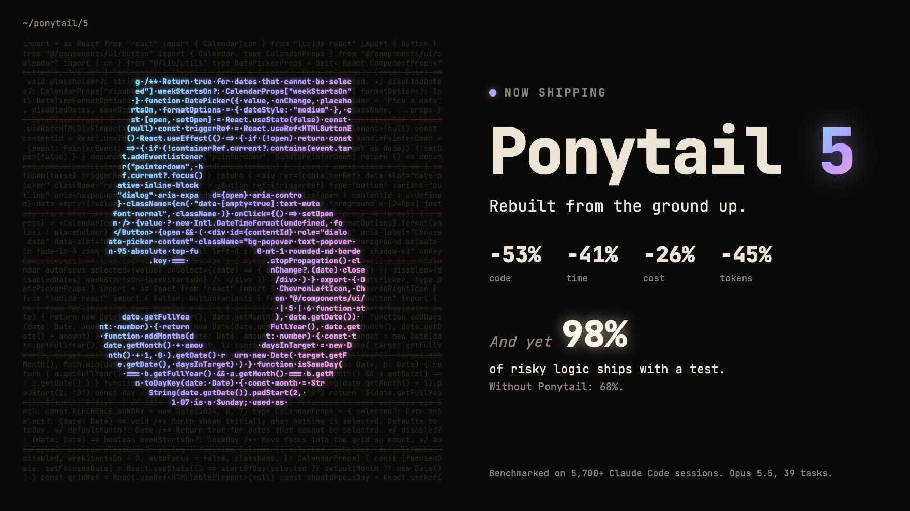
</p>

<p align="center">
  <strong>Ponytail 5: przebudowany od podstaw.</strong><br>
  <strong>-53% kodu &middot; -41% czasu &middot; -26% kosztów &middot; -45% tokenów</strong><br>
  <strong>A mimo to: 98% ryzykownej logiki ma test.</strong> Bez Ponytaila: 68%.<br>
  <sub>Zmierzone w Claude Code, ten sam agent ze skillem i bez niego: 39 zadań, w tym prawdziwe repo FastAPI + React, Opus 5.5, po 5 przebiegów każde. <a href="#numbers">Szczegóły</a>.</sub>
</p>

<p align="center">
  <sub><a href="../README.md">English</a> &middot; <a href="README.es.md">Español</a> &middot; <a href="README.ko.md">한국어</a> &middot; <a href="README.zh-CN.md">简体中文</a> &middot; <a href="README.ja.md">日本語</a> &middot; Polski &middot; <a href="README.cs.md">Čeština</a> &middot; <a href="README.sk.md">Slovenčina</a></sub><br>
  <sub>Tłumaczenie angielskiego README. W razie rozbieżności obowiązuje <a href="../README.md">wersja angielska</a>.</sub>
</p>

---

<p align="center">
  <a href="https://ponytail.dev/soon">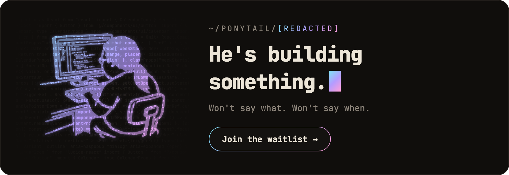</a>
</p>

## Już zbudowane z Ponytailem

<a href="https://theretriever.app">
  <picture>
    <source media="(prefers-color-scheme: dark)" srcset="../assets/retriever-logo-dark.svg">
    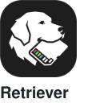
  </picture>
</a>
<a href="https://photoreunion.app/?ref=ponytail-gh">
  <picture>
    <source media="(prefers-color-scheme: dark)" srcset="../assets/photoreunion-logo-dark.svg">
    
  </picture>
</a>

---

Znasz go. Długi kucyk. Owalne okulary. Pracuje w firmie dłużej, niż istnieje w niej kontrola wersji. Pokazujesz mu pięćdziesiąt linijek; patrzy na nie, nic nie mówi i zastępuje je jedną.

Ponytail umieszcza go w twoim agencie AI.

<a id="numbers"></a>
## Liczby

<p align="center">
  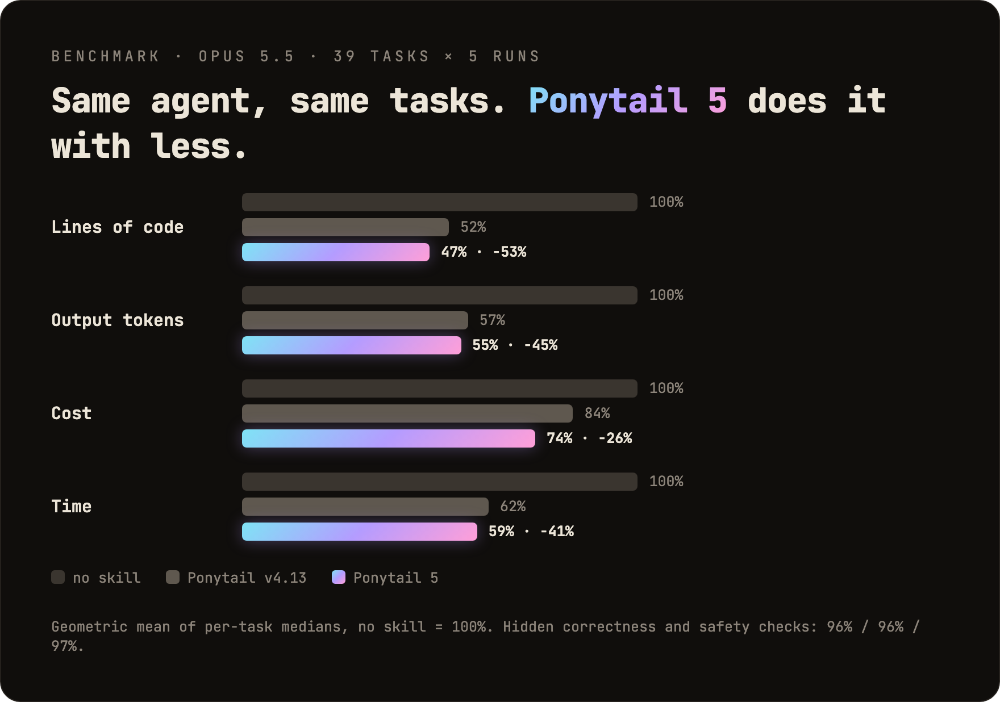
</p>

<p align="center">
  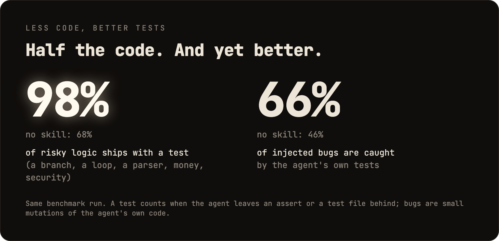
</p>

Dwie rzeczy, których wykres nie pokazuje: w ślepym porównaniu odpowiedzi Ponytaila 5 wygrały z odpowiedziami poprzedniego Ponytaila 110 do 67. A w sześciu zadaniach z zakresu bezpieczeństwa (SQL injection, path traversal, sfałszowane tokeny, rate limiting, błędne wiersze CSV, cache) zaliczył wszystkie 30 przebiegów: mniej kodu, a bezpieczeństwo bez uszczerbku. Metoda, tabele dla poszczególnych zadań i ograniczenia: [benchmarks/results/2026-10-07-agentic.md](../benchmarks/results/2026-10-07-agentic.md).

**Zasadą nigdy nie było „jak najmniej tokenów”.** Zasada brzmi: pisz tylko to, czego wymaga zadanie, i nigdy nie wycinaj walidacji, obsługi błędów, bezpieczeństwa ani dostępności. Kod wychodzi mały, bo zawiera tylko to, co niezbędne, a nie dlatego, że ktoś bawił się w code golfa. Niższy koszt i mniejsze opóźnienia to efekt uboczny.

## Przed / po

<p align="center">
  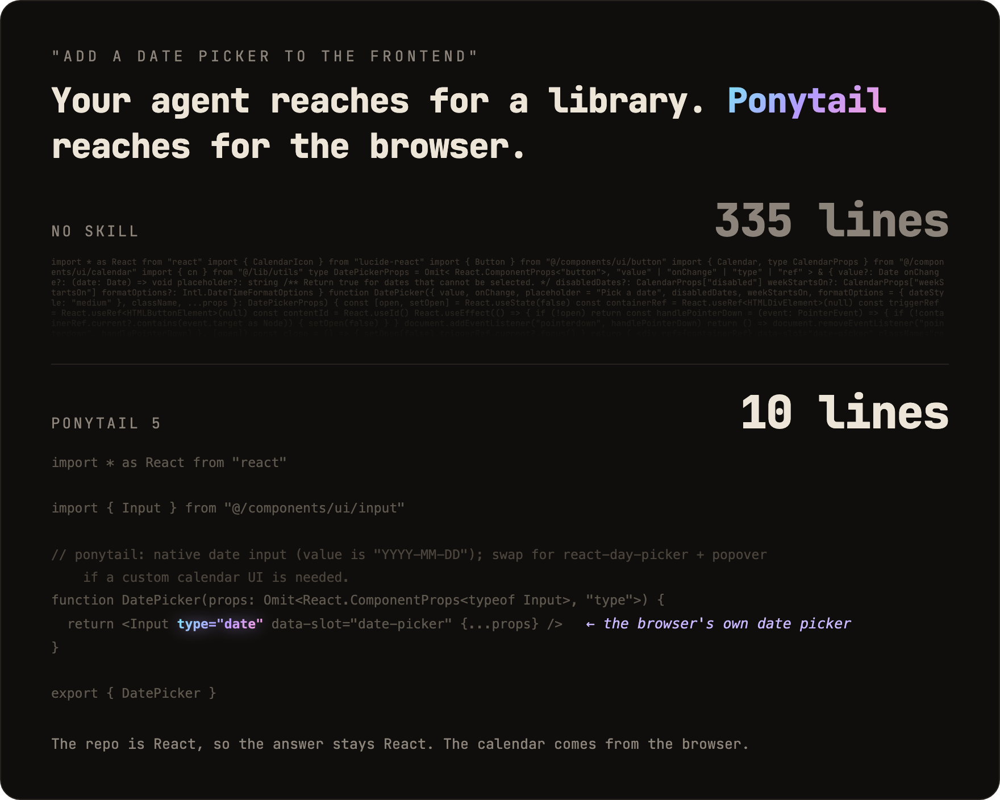
</p>

Prosisz o date picker. Bez Ponytaila agent instaluje bibliotekę z date pickerem albo buduje ręcznie cały kalendarz: 335 linijek. Ponytail 5 najpierw sprawdza, co już jest: repo ma komponent `Input`, a każda przeglądarka ma wbudowany wybór daty. Łączy jedno z drugim. 10 linijek.

Więcej ocalałych w [examples/](../examples/).

## Review przebudowane od podstaw

<p align="center">
  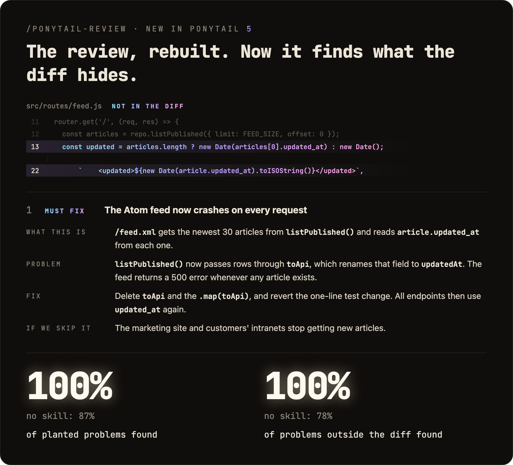
</p>

`/ponytail-review` szukał kiedyś tylko kodu do wycięcia. Teraz robi review jak senior dev, którego budzą, gdy coś padnie: czyta kod, którego dotyka twoja zmiana, a nie tylko diff, i sprawdza błędy, bezpieczeństwo, realne obciążenie, brakujące testy, szybkość oraz to, co można wyciąć. Każde zgłoszenie mówi, co robi kod, co idzie nie tak, jak to naprawić i co się stanie, jeśli tego nie zrobisz.

## Audyt przebudowany od podstaw

<p align="center">
  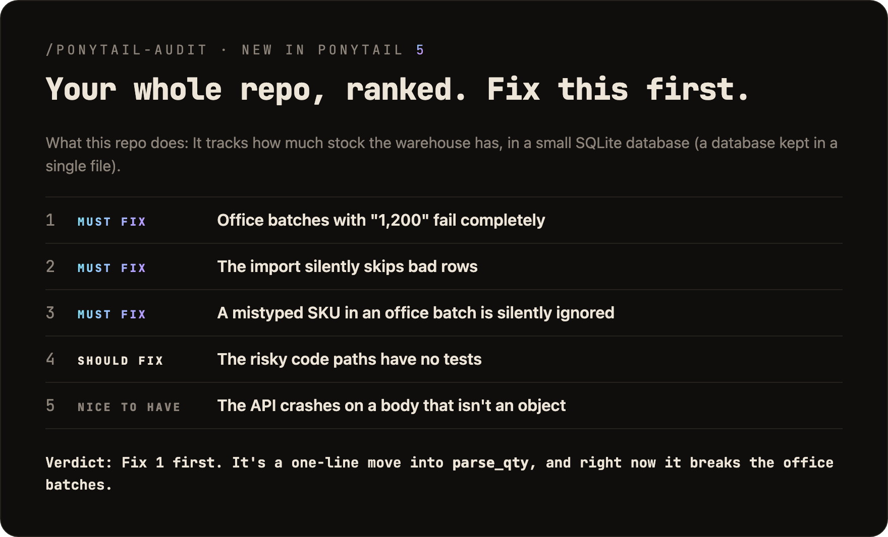
</p>

`/ponytail-audit` wykonuje te same sprawdzenia na całym repo. Najpierw mapuje kod: punkty wejścia, przepływ danych, spodziewane obciążenie projektu. Potem układa znaleziska według ważności i mówi, co naprawić najpierw. Stary audyt tylko wymieniał, co usunąć.

## Nowość w 5.3: pasek

<p align="center">
  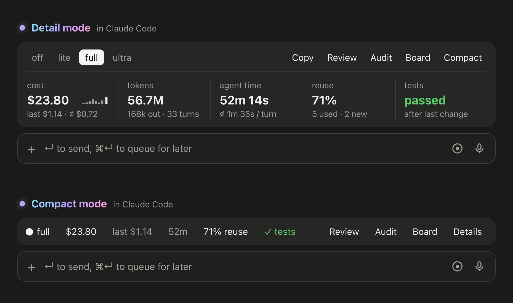
</p>

W Claude Code ponytail pokazuje teraz pasek nad promptem: ile kosztuje bieżące zadanie, ile zużyło tokenów i czasu agenta, jak często wykorzystało istniejący kod zamiast pisać nowy i czy testy przeszły po ostatniej zmianie. Przyciski paska przełączają poziom, uruchamiają `/ponytail-review` lub `/ponytail-audit`, kopiują zadanie jako Markdown i zwijają pasek do jednej linii. Nie chcesz go? `/ponytail band` go ukrywa, a to samo polecenie przywraca. Wymaga Claude Code 2.1.290 lub nowszego, w terminalu albo aplikacji desktopowej. Nie pojawia się w panelu czatu VS Code, w sesjach w chmurze ani w `claude -p`.

<p align="center">
  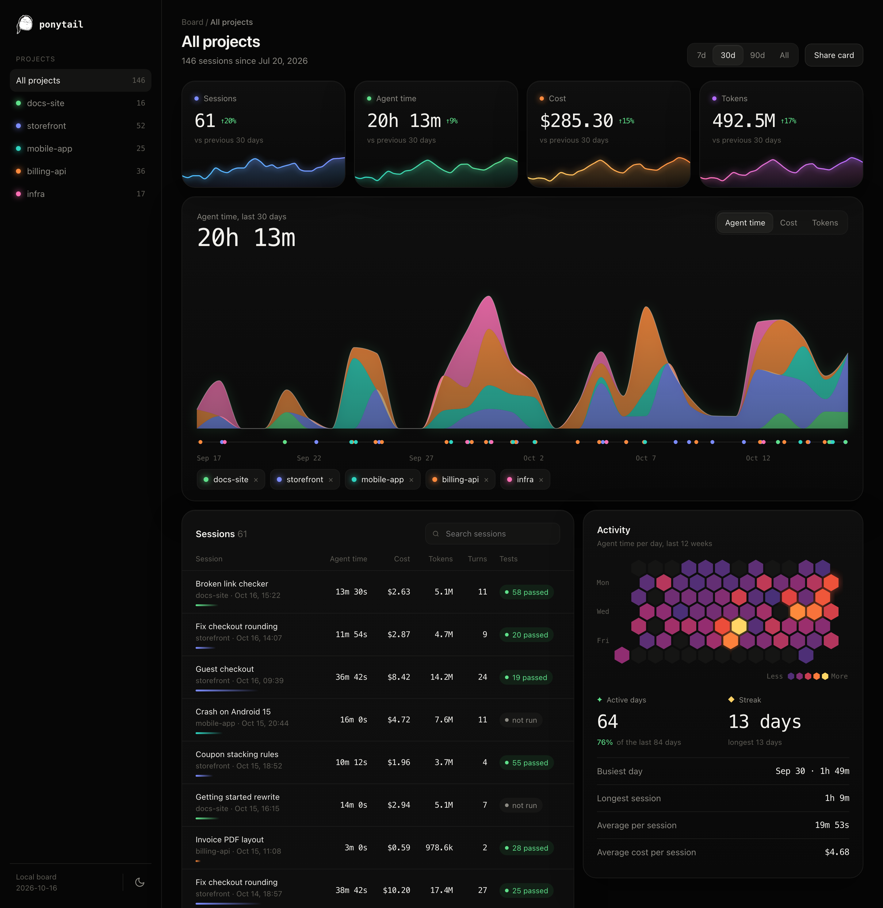
</p>

**Board** otwiera lokalną stronę ze wszystkimi zadaniami z twoich projektów: koszt, czas agenta i tokeny w czasie, każda sesja z jej testami oraz dni pracy. Domyślnie wszystko zostaje na twoim komputerze, w `~/.config/ponytail/band/`. `/ponytail band import` dodaje do niego twoje wcześniejsze sesje Claude Code wraz z ich kosztem, czasem agenta i tokenami.

## Jak to działa

<p align="center">
  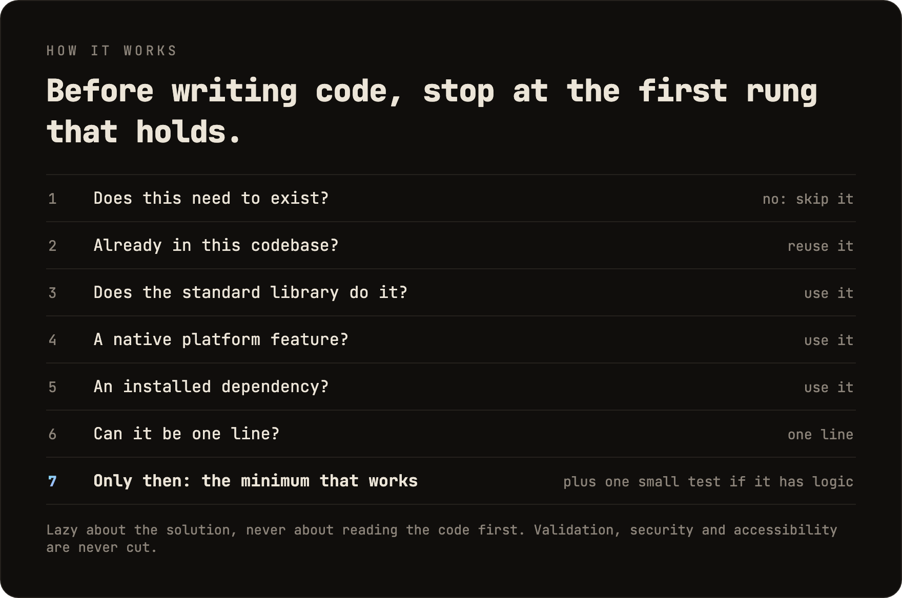
</p>

Drabina działa *po* zrozumieniu problemu, nie zamiast niego: zanim wybierze szczebel, czyta kod, którego dotyka zmiana, i śledzi rzeczywisty przepływ. Leniwy w rozwiązaniu, nigdy w czytaniu.

Leniwy, nie niedbały: walidacja na granicach zaufania, ochrona przed utratą danych, bezpieczeństwo i dostępność nigdy nie idą pod nóż.

Logika z rozgałęzieniem, pętlą, parserem, pieniędzmi lub bezpieczeństwem zostawia po sobie jeden mały test. Każda odpowiedź kończy się informacją, co pominięto lub czego nie sprawdzono, oraz o ryzyku, o którym musisz wiedzieć.

## Prompt

Ponytail to jeden prompt: [`skills/ponytail/SKILL.md`](../skills/ponytail/SKILL.md). Wersja kompaktowa, dla agentów czytających plik z regułami, to [`AGENTS.md`](../AGENTS.md). Cała reszta tego repo ładuje ten prompt do różnych agentów.

## Instalacja

**Claude Code**, jako dwa osobne prompty:

```
/plugin marketplace add DietrichGebert/ponytail
```
```
/plugin install ponytail@ponytail
```

**Codex:**

```bash
codex plugin marketplace add DietrichGebert/ponytail
codex plugin add ponytail@ponytail
```

Następnie otwórz `/hooks` w Codex, zaufaj jego dwóm hookom cyklu życia i rozpocznij nowy wątek.

**Każdy inny agent:** skopiuj [`AGENTS.md`](../AGENTS.md) do swojego projektu albo poproś agenta, żeby zainstalował [`skills/ponytail/SKILL.md`](../skills/ponytail/SKILL.md) jako skill. Krok po kroku dla Copilota, Cursora, OpenCode, Gemini i reszty (po angielsku): **[INSTALL.md](../INSTALL.md)**.

To wszystko. Byłby dumny. Nie powie tego.

Aktywny w każdej sesji, z garścią poleceń (zobacz [Polecenia](#commands)). `/ponytail ultra` istnieje na wypadek, gdy kod skrzywdził cię osobiście. Tekst startowy i tekst przy zmianie trybu pokazują bieżący tryb.

Instaluj ponytail wyłącznie z `DietrichGebert/ponytail` na GitHubie lub `@dietrichgebert/ponytail` na npm. Nigdy nie zawiera plików `.exe` ani `.dll`; kopia, która je zawiera, nie jest moja.

<a id="commands"></a>
## Polecenia

| Polecenie | Co robi |
|-----------|---------|
| `/ponytail [lite \| full \| ultra \| off]` | Ustawia intensywność lub wyłącza. Bez argumentu włącza ponytail na domyślnym poziomie, jeśli jest wyłączony, a w przeciwnym razie podaje bieżący poziom. |
| `/ponytail band [on \| off]` | Tylko Claude Code: ukrywa lub pokazuje pasek nad promptem. Bez argumentu przełącza. Poziom się nie zmienia. |
| `/ponytail band import` | Tylko Claude Code: dodaje twoje wcześniejsze sesje Claude Code do boardu, wraz z kosztem, czasem agenta i tokenami. |
| `/ponytail-review` | Robi review bieżącego diffa jak senior dev, którego budzą, gdy coś padnie: błędy, bezpieczeństwo, realne obciążenie, ryzykowny kod bez testu, wolne ścieżki i to, co można wyciąć. Każde zgłoszenie mówi, co robi kod, co idzie nie tak, jak to naprawić i co się stanie, jeśli tego nie zrobisz. Podaj cel zwykłymi słowami, żeby zawęzić lub rozszerzyć zakres: `uncommitted`, `staged`, `branch` lub link do PR. |
| `/ponytail-audit` | To samo sprawdzenie dla całego repo, najważniejsze najpierw. |
| `/ponytail-debt` | Zbiera odłożone komentarze `shortcut:` do rejestru, żeby „później” nie stało się „nigdy”. |
| `/ponytail-gain` | Pokazuje tablicę zmierzonych efektów (mniej kodu, niższy koszt, większa szybkość) z benchmarku. |
| `/ponytail-help` | Krótka ściąga z powyższych poleceń. |

Polecenia wymagają hosta obsługującego skille (Claude Code, Codex, Devin CLI, OpenCode, Gemini, Antigravity CLI, pi, Hermes Agent, Qoder, Grok Build). W Codex CLI i rozszerzeniu IDE są to skille w przestrzeni nazw pluginu; wywołuje się je przez `$ponytail:ponytail-review`. Cursor z [hookami](../INSTALL.md#cursor) ma tylko przełączanie poziomu przez `/ponytail`, wpisywane jako zwykła wiadomość. Adaptery oparte wyłącznie na instrukcjach (plik reguł Cursora, Windsurf, Cline, Copilot, Kiro, awaryjny `AGENTS.md` w Antigravity) ładują zawsze aktywny zestaw reguł bez poleceń.

## FAQ

**Czy potrzebuje pliku konfiguracyjnego?**
Nie. Opcjonalny `~/.config/ponytail/config.json` lub zmienna środowiskowa `PONYTAIL_DEFAULT_MODE` mogą ustawić domyślny poziom, ale nic nie jest wymagane.

**Dlaczego pisze komentarze `shortcut:`?**
Oznaczają świadomy skrót i moment, w którym warto do niego wrócić, a `/ponytail-debt` zbiera je do rejestru. Chcesz inne słowo albo żadnego? Napisz to w `CLAUDE.md` lub `AGENTS.md` swojego projektu, a potem uruchom `/ponytail-debt <twoje słowo>`.

**A jeśli naprawdę potrzebuję tej 120-linijkowej klasy cache?**
Nie potrzebujesz. Upieraj się, a ją zbuduje. Powoli. Poprawnie. Patrząc na ciebie.

**Czy to się skaluje?**
Kod, który nigdy nie powstał, skaluje się w nieskończoność. Zero błędów, zero CVE, 100% dostępności od zawsze.

**Dlaczego „ponytail”?**
Dobrze wiesz dlaczego.

## Sponsorzy

<p align="center">
  <a href="https://greenpt.com/">
    <picture>
      <source media="(prefers-color-scheme: dark)" srcset="../assets/logo-greenpt-dark.svg">
      
    </picture>
  </a>
</p>

## Licencja

[MIT](../LICENSE). Najkrótsza licencja, która działa.

## Historia gwiazdek

<a href="https://www.star-history.com/dietrichgebert/ponytail#history">
 <picture>
   <source media="(prefers-color-scheme: dark)" srcset="https://api.star-history.com/chart?repos=DietrichGebert/ponytail&type=Date&theme=dark" />
   <source media="(prefers-color-scheme: light)" srcset="https://api.star-history.com/chart?repos=DietrichGebert/ponytail&type=Date" />
   
 </picture>
</a>
