<p align="center">
  <picture>
    <source media="(prefers-color-scheme: dark)" srcset="../assets/logo-dark.png">
    
  </picture>
</p>

<h1 align="center">Ponytail</h1>

<p align="center">
  <em>Nič nehovorí. Napíše jeden riadok. Funguje to.</em>
</p>

<p align="center">
  <a href="https://trendshift.io/repositories/50668?utm_source=repository-badge&amp;utm_medium=badge&amp;utm_campaign=badge-repository-50668" target="_blank" rel="noopener noreferrer"></a>
</p>

<p align="center">
  
  
  
  
  
</p>

<p align="center">
  <a href="https://trendshift.io/repositories/50668" target="_blank" rel="noopener noreferrer"></a>
  <a href="https://trendshift.io/repositories/50668" target="_blank" rel="noopener noreferrer"></a>
  <a href="https://trendshift.io/repositories/50668?utm_source=trendshift-badge&amp;utm_medium=badge&amp;utm_campaign=badge-trendshift-50668" target="_blank" rel="noopener noreferrer"></a>
</p>

<p align="center">
  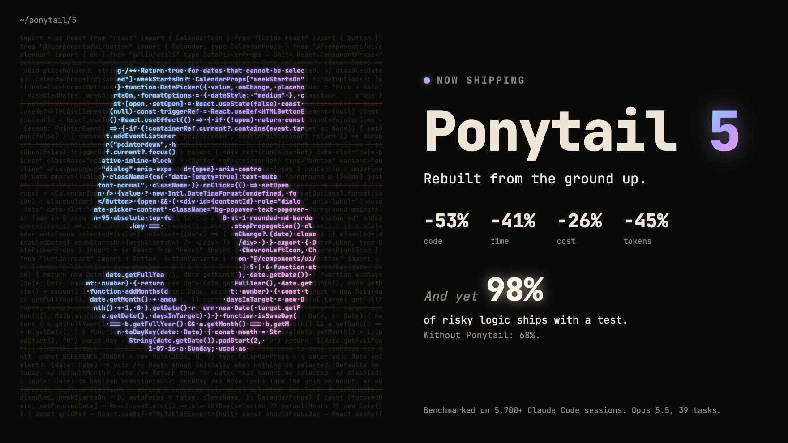
</p>

<p align="center">
  <strong>Ponytail 5: prebudovaný od základov.</strong><br>
  <strong>-53 % kódu &middot; -41 % času &middot; -26 % nákladov &middot; -45 % tokenov</strong><br>
  <strong>A predsa: 98 % rizikovej logiky má test.</strong> Bez Ponytailu: 68 %.<br>
  <sub>Merané v Claude Code, ten istý agent so skillom a bez neho: 39 úloh vrátane skutočného repozitára FastAPI + React, Opus 5.5, každá po 5 behoch. <a href="#numbers">Podrobnosti</a>.</sub>
</p>

<p align="center">
  <sub><a href="../README.md">English</a> &middot; <a href="README.es.md">Español</a> &middot; <a href="README.ko.md">한국어</a> &middot; <a href="README.zh-CN.md">简体中文</a> &middot; <a href="README.ja.md">日本語</a> &middot; <a href="README.pl.md">Polski</a> &middot; <a href="README.cs.md">Čeština</a> &middot; Slovenčina</sub><br>
  <sub>Preklad anglického README. V prípade rozporu platí <a href="../README.md">anglická verzia</a>.</sub>
</p>

---

<p align="center">
  <a href="https://ponytail.dev/soon">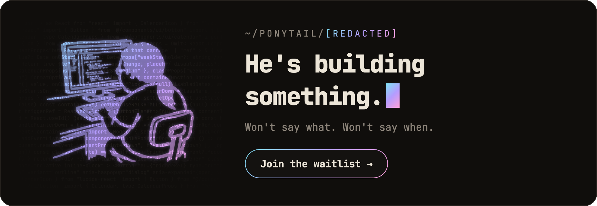</a>
</p>

## Už postavené s Ponytailom

<a href="https://theretriever.app">
  <picture>
    <source media="(prefers-color-scheme: dark)" srcset="../assets/retriever-logo-dark.svg">
    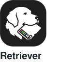
  </picture>
</a>
<a href="https://photoreunion.app/?ref=ponytail-gh">
  <picture>
    <source media="(prefers-color-scheme: dark)" srcset="../assets/photoreunion-logo-dark.svg">
    
  </picture>
</a>

---

Poznáš ho. Dlhý konský chvost. Oválne okuliare. Vo firme je dlhšie ako správa verzií. Ukážeš mu päťdesiat riadkov; pozrie sa na ne, nič nepovie a nahradí ich jedným.

Ponytail ho dostane do tvojho AI agenta.

<a id="numbers"></a>
## Čísla

<p align="center">
  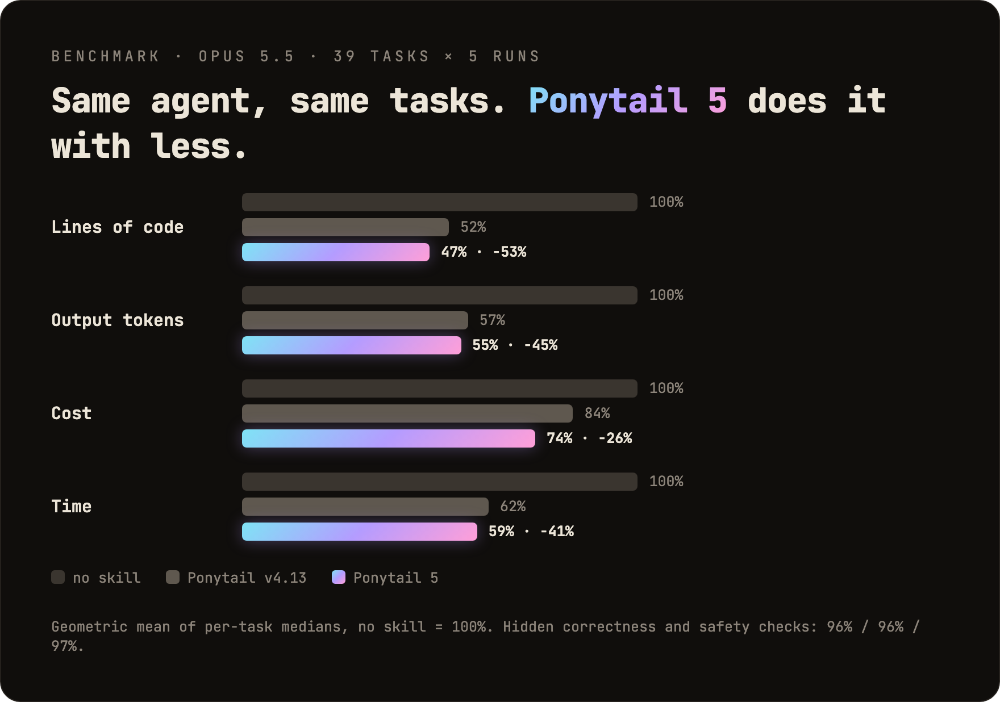
</p>

<p align="center">
  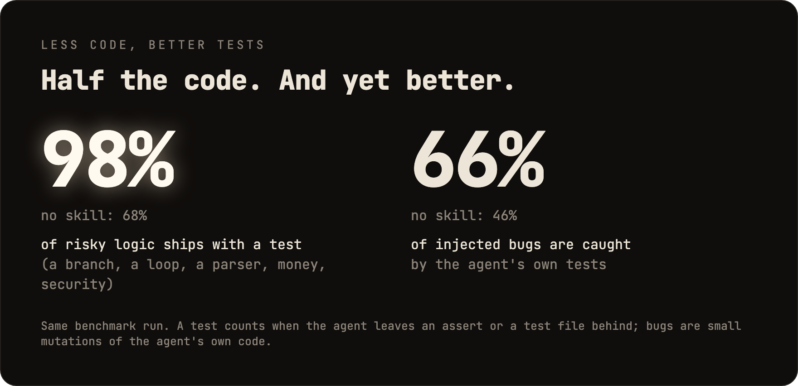
</p>

Dve veci, ktoré graf neukazuje: v slepom porovnaní porazili odpovede Ponytailu 5 odpovede predchádzajúceho Ponytailu 110 ku 67. A v šiestich bezpečnostných úlohách (SQL injection, path traversal, sfalšované tokeny, rate limiting, poškodené riadky CSV, cachovanie) prešiel všetkými 30 behmi: menej kódu, bezpečnosť rovnaká. Metóda, tabuľky po úlohách a obmedzenia: [benchmarks/results/2026-10-07-agentic.md](../benchmarks/results/2026-10-07-agentic.md).

**Pravidlom nikdy nebolo „čo najmenej tokenov“.** Pravidlo znie: píš len to, čo úloha potrebuje, a nikdy neškrtaj validáciu, ošetrenie chýb, bezpečnosť ani prístupnosť. Kód vyjde malý, lebo obsahuje len to nevyhnutné, nie preto, že by bol umelo skracovaný. Nižšie náklady a latencia sú vedľajší efekt.

## Pred / po

<p align="center">
  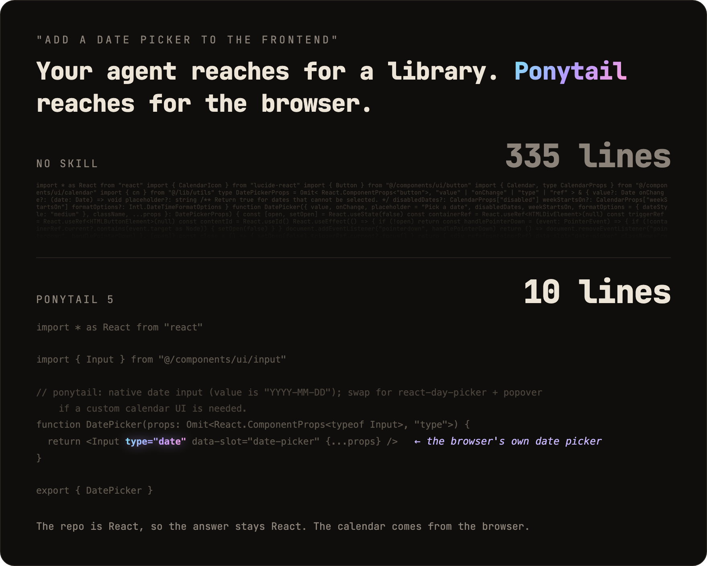
</p>

Požiadaš o výber dátumu. Bez Ponytailu agent nainštaluje knižnicu na výber dátumu alebo ručne postaví celý kalendár: 335 riadkov. Ponytail 5 sa najprv pozrie, čo už existuje: repozitár má komponent `Input` a každý prehliadač má výber dátumu. Spojí oboje. 10 riadkov.

Ďalší preživší v [examples/](../examples/).

## Review, prebudované od základov

<p align="center">
  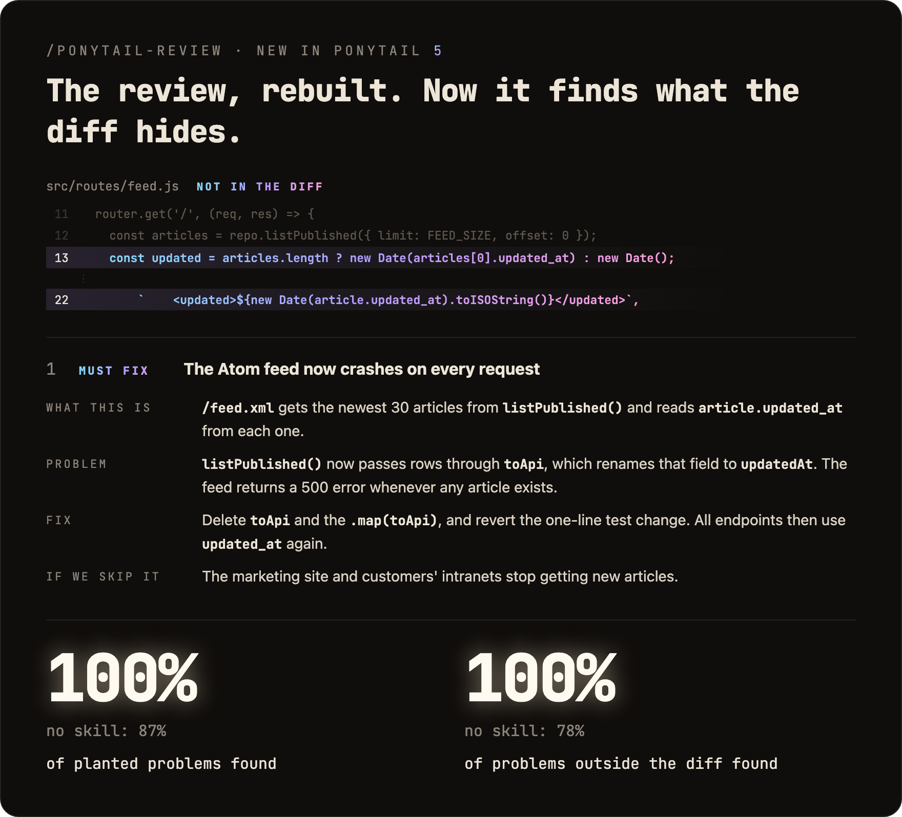
</p>

`/ponytail-review` kedysi hľadal len kód na odstránenie. Teraz robí review ako senior vývojár, ktorého budí pager, keď sa niečo pokazí: číta kód, ktorého sa tvoja zmena dotýka, nielen diff, a kontroluje chyby, bezpečnosť, reálnu záťaž, chýbajúce testy, rýchlosť a to, čo sa dá vyhodiť. Každý nález hovorí, čo kód robí, čo sa pokazí, ako to opraviť a čo sa stane, keď to neopravíš.

## Audit, prebudovaný od základov

<p align="center">
  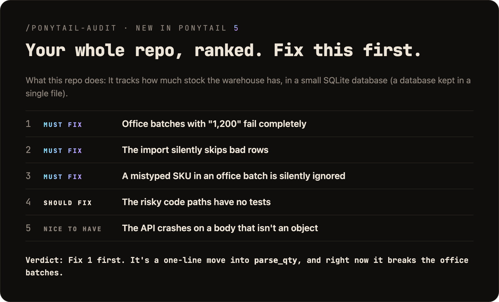
</p>

`/ponytail-audit` spúšťa rovnaké kontroly na celom repozitári. Najprv zmapuje kód: vstupné body, ako sa pohybujú dáta, akú záťaž projekt očakáva. Potom zoradí, čo našiel, podľa dôležitosti a povie ti, čo opraviť ako prvé. Starý audit len vypisoval, čo zmazať.

## Novinka v 5.3: lišta

<p align="center">
  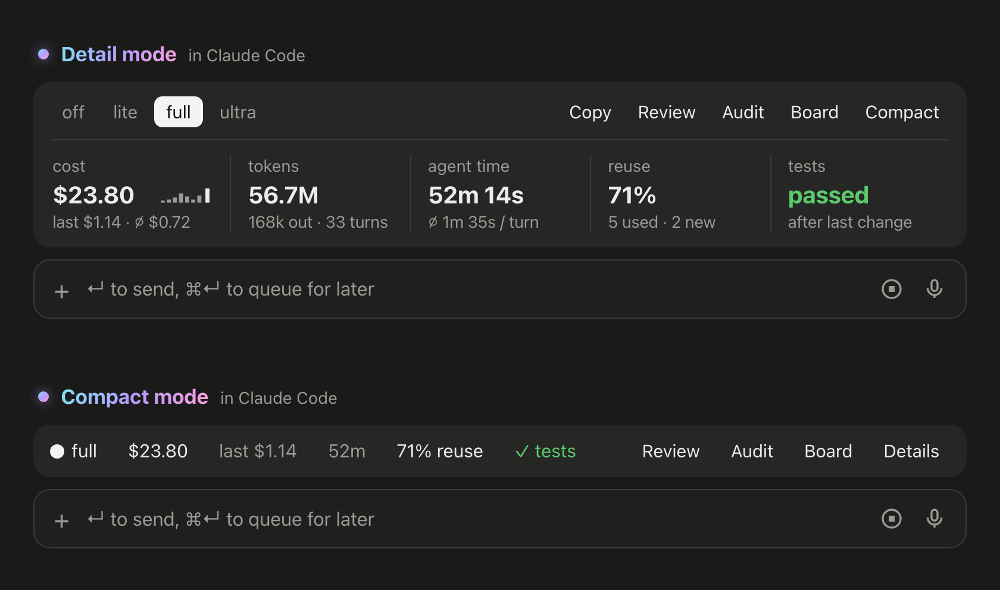
</p>

V Claude Code teraz ponytail ukazuje lištu nad promptom: koľko stojí aktuálna úloha, koľko tokenov a času agenta spotrebovala, ako často znovu použila existujúci kód namiesto písania nového a či testy prešli po poslednej zmene. Jej tlačidlá prepínajú úroveň, spúšťajú `/ponytail-review` alebo `/ponytail-audit`, kopírujú úlohu ako Markdown a zbalia lištu na jeden riadok. Nechceš ju? `/ponytail band` ju skryje, ten istý príkaz ju vráti späť. Vyžaduje Claude Code 2.1.290 alebo novší, v termináli alebo v desktopovej aplikácii. Nezobrazuje sa v chatovom paneli VS Code, v cloudových reláciách ani v `claude -p`.

<p align="center">
  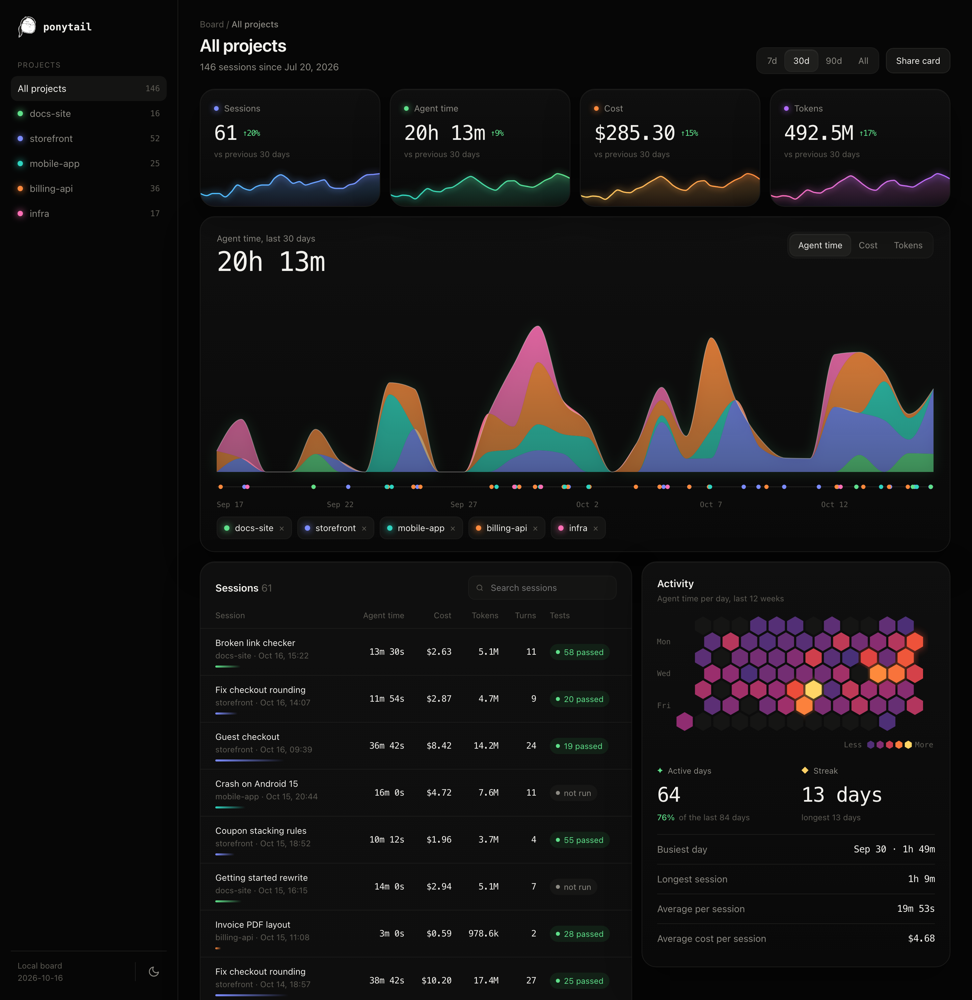
</p>

**Board** otvorí lokálnu stránku so všetkými úlohami naprieč tvojimi projektmi: náklady, čas agenta a tokeny v priebehu času, každá relácia s jej testami a dni, keď sa pracovalo. Predvolene všetko zostáva na tvojom počítači, v `~/.config/ponytail/band/`. `/ponytail band import` doň pridá tvoje staršie relácie Claude Code, s ich nákladmi, časom agenta a tokenmi.

## Ako to funguje

<p align="center">
  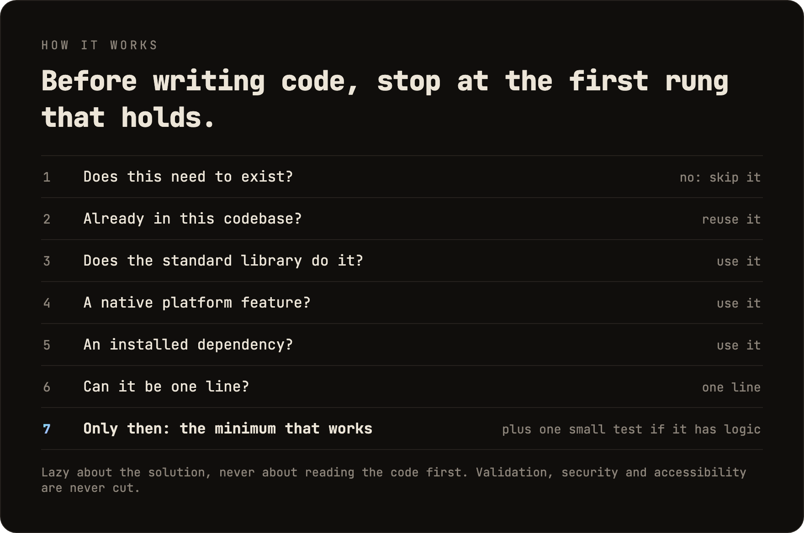
</p>

Rebrík beží *až potom*, čo pochopí problém, nie namiesto toho: skôr než vyberie priečku, prečíta kód, ktorého sa zmena dotýka, a sleduje skutočný tok. Lenivý na riešenie, nikdy na čítanie.

Lenivý, nie nedbalý: validácia na hraniciach dôvery, ochrana pred stratou dát, bezpečnosť a prístupnosť nikdy nejdú pod nôž.

Logika s vetvením, cyklom, parserom, peniazmi alebo bezpečnosťou po sebe nechá jeden malý test. Každá odpoveď končí tým, čo sa preskočilo alebo neskontrolovalo, a každým rizikom, o ktorom je dobré vedieť.

## Prompt

Ponytail je jeden prompt: [`skills/ponytail/SKILL.md`](../skills/ponytail/SKILL.md). Kompaktná verzia, pre agentov, ktorí čítajú súbor s pravidlami, je [`AGENTS.md`](../AGENTS.md). Všetko ostatné v tomto repozitári ten prompt načítava do rôznych agentov.

## Inštalácia

**Claude Code**, ako dva samostatné prompty:

```
/plugin marketplace add DietrichGebert/ponytail
```
```
/plugin install ponytail@ponytail
```

**Codex:**

```bash
codex plugin marketplace add DietrichGebert/ponytail
codex plugin add ponytail@ponytail
```

Potom v Codexe otvor `/hooks`, dôveruj jeho dvom lifecycle hookom a začni nové vlákno.

**Akýkoľvek iný agent:** skopíruj [`AGENTS.md`](../AGENTS.md) do svojho projektu, alebo požiadaj svojho agenta, nech nainštaluje [`skills/ponytail/SKILL.md`](../skills/ponytail/SKILL.md) ako skill. Krok za krokom pre Copilot, Cursor, OpenCode, Gemini a ostatné (po anglicky): **[INSTALL.md](../INSTALL.md)**.

To bolo všetko. Bol by hrdý. Nepovie to.

Aktívny v každej relácii, s hŕstkou príkazov (pozri [Príkazy](#commands)). `/ponytail ultra` existuje pre chvíle, keď ti kód osobne ublížil. Text pri spustení a pri zmene režimu ukazuje aktuálny režim.

Inštaluj ponytail len z `DietrichGebert/ponytail` na GitHube alebo `@dietrichgebert/ponytail` na npm. Nikdy neobsahuje súbory `.exe` ani `.dll`; kópia, ktorá ich obsahuje, nie je moja.

<a id="commands"></a>
## Príkazy

| Príkaz | Čo robí |
|--------|---------|
| `/ponytail [lite \| full \| ultra \| off]` | Nastaví intenzitu alebo ho vypne. Bez argumentu zapne ponytail na predvolenej úrovni, ak je vypnutý, inak oznámi aktuálnu úroveň. |
| `/ponytail band [on \| off]` | Len Claude Code: skryje alebo zobrazí lištu nad promptom. Bez argumentu prepne. Úroveň zostáva. |
| `/ponytail band import` | Len Claude Code: pridá tvoje staršie relácie Claude Code na board, s ich nákladmi, časom agenta a tokenmi. |
| `/ponytail-review` | Skontroluje aktuálny diff ako senior vývojár, ktorého budí pager, keď sa niečo pokazí: chyby, bezpečnosť, reálna záťaž, rizikový kód bez testu, pomalé cesty a čo sa dá vyhodiť. Každý nález hovorí, čo kód robí, čo sa pokazí, ako to opraviť a čo sa stane, keď to neopravíš. Cieľ môžeš zúžiť alebo rozšíriť bežnými slovami: `uncommitted`, `staged`, `branch` alebo odkaz na PR. |
| `/ponytail-audit` | Rovnaká kontrola pre celý repozitár, najdôležitejšie veci ako prvé. |
| `/ponytail-debt` | Zozbiera odložené komentáre `shortcut:` do evidencie, aby sa z „neskôr“ nestalo „nikdy“. |
| `/ponytail-gain` | Ukáže tabuľku nameraného dopadu (menej kódu, nižšie náklady, vyššia rýchlosť) z benchmarku. |
| `/ponytail-help` | Rýchly prehľad vyššie uvedených príkazov. |

Príkazy vyžadujú hostiteľa s podporou skillov (Claude Code, Codex, Devin CLI, OpenCode, Gemini, Antigravity CLI, pi, Hermes Agent, Qoder, Grok Build). V Codex CLI a rozšírení pre IDE sú to skilly v mennom priestore pluginu; volajú sa cez `$ponytail:ponytail-review`. Cursor s [hookmi](../INSTALL.md#cursor) má len prepínanie úrovne cez `/ponytail`, písané ako bežná správa. Adaptéry založené len na inštrukciách (súbor pravidiel Cursora, Windsurf, Cline, Copilot, Kiro, záložný `AGENTS.md` v Antigravity) načítavajú vždy aktívnu sadu pravidiel bez príkazov.

## Časté otázky

**Potrebuje konfiguračný súbor?**
Nie. Predvolenú úroveň môže nastaviť voliteľný `~/.config/ponytail/config.json` alebo premenná prostredia `PONYTAIL_DEFAULT_MODE`, ale nič z toho nie je nutné.

**Prečo píše komentáre `shortcut:`?**
Označujú zámernú skratku a kedy sa k nej vrátiť, a `/ponytail-debt` ich zozbiera do evidencie. Chceš iné slovo, alebo žiadne? Napíš to do `CLAUDE.md` alebo `AGENTS.md` svojho projektu a potom spusti `/ponytail-debt <tvoje slovo>`.

**Čo ak tú 120-riadkovú cache triedu naozaj potrebujem?**
Nepotrebuješ. Keď budeš trvať na svojom, postaví ju. Pomaly. Správne. A bude sa pritom na teba pozerať.

**Škáluje to?**
Kód, ktorý nikdy nevznikol, škáluje do nekonečna. Nula chýb, nula CVE, 100 % dostupnosť odjakživa.

**Prečo „ponytail“?**
Veľmi dobre vieš prečo.

## Sponzori

<p align="center">
  <a href="https://greenpt.com/">
    <picture>
      <source media="(prefers-color-scheme: dark)" srcset="../assets/logo-greenpt-dark.svg">
      
    </picture>
  </a>
</p>

## Licencia

[MIT](../LICENSE). Najkratšia licencia, ktorá funguje.

## História hviezdičiek

<a href="https://www.star-history.com/dietrichgebert/ponytail#history">
 <picture>
   <source media="(prefers-color-scheme: dark)" srcset="https://api.star-history.com/chart?repos=DietrichGebert/ponytail&type=Date&theme=dark" />
   <source media="(prefers-color-scheme: light)" srcset="https://api.star-history.com/chart?repos=DietrichGebert/ponytail&type=Date" />
   
 </picture>
</a>
